# HM64 Power Nut Tool v32.18

A timing aid for catching the **Power Nut** from the ocean pier in **Harvest Moon 64 (USA, NTSC)** on a real N64.
The site's front page (`index.html`) is a **hub**: tick what is true of your game file (a rainy morning, the horse; married
and a baby come later) and three buttons — always the same — open that file's **Casting tables**, **Lucky Timer** and
**Dog practice**. Each page is one file that holds
only that game file's tables, runs entirely in your browser, needs no install and sends nothing anywhere (no network
requests). Save a page (right-click its link in the hub → *Save link as…*) and it works offline. The site also has three
help pages, each its own page: the **Guide** (`guide.html`: how to set up each game file, the route and the beach),
**Not working?** (`not-working.html`: what to check when it does not work) and **How it works** (`how-it-works.html`: the
forest pictures). Every tool page links them, and its **Not working?** button opens a checklist that leads to the answers.
Your keys, your timing, your practice drills and one attempt count for every page are on the **Settings** page
(`settings.html`, a button on the hub and a link in every tool page's footer): see [Settings](#settings-your-keys-timing-and-practice-in-one-place).

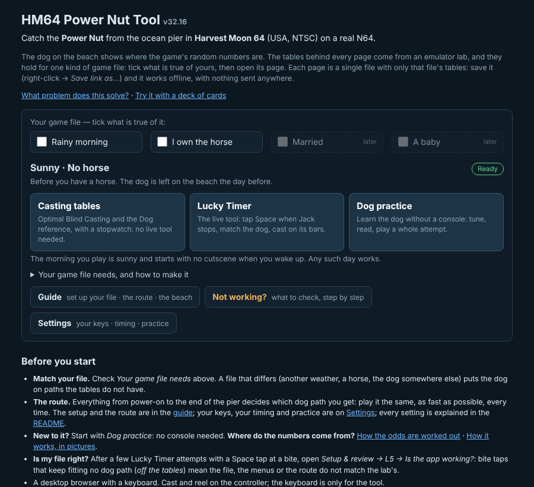

<sub><b>The hub (v32.12).</b> Under the intro, two small links: <i>What problem does this solve?</i> (its own page,
<code>problem.html</code>) and the deck page (below). Nothing ticked = Sunny → No horse. Ready today: <b>Sunny → No horse</b>, <b>Sunny → Horse</b>
(tick <i>I own the horse</i>), <b>Rainy → No horse</b> and <b>Rainy → Horse</b> (tick <i>Rainy morning</i>; v32.18), each with
Casting tables, a Lucky Timer and Dog practice. A marriage and a baby come later, each with its own tables. The hub remembers your ticks, and a link like <code>…/#sunny-horse</code> opens it on
that file. Every page is beach-lineup2: the dog left
in the far south-west corner of the beach; you pick your tables by your game file. Under the buttons: <b>Guide</b> and
<b>Not working?</b>, both opened on the game file you ticked.</sub>

Every random event in the game comes from one random number generator. The dog's behaviour on the beach is a
readout of where that generator is, and an emulator lab has recorded, for every dog path ("line") and every cast frame
up to 120 s after Jack reaches the end of the pier, every bite and what it catches. The page shows you the dog the lab
expects, lets you line it up with the dog on your TV, and tells you when to press B and when to let go.
Every percentage on the pages is a share of the lab's plays of the route that land the Nut; [How the odds are worked
out](#how-the-odds-are-worked-out) says how, in plain English.

---

## The problem it solves: top-decking one card
Catching the Power Nut is like drawing one card you picked beforehand — the ace of spades, say — from a shuffled deck of
51. But you cannot draw whenever you like. You draw by casting: the game frame you press B on (1/30 s) picks the cast, and
with it every bite that will come. Then you hold B and wait. Each bite gives you 0.33 s to let go of B and pull in; let go
early, late, or hold on through it, and that card is gone. Which bite is your card, you cannot see.

The deck never holds still. Every frame it reshuffles with the game's random number, so a cast one frame earlier or later
is another cast with other bites. Each arrival at the beach hands you a different deck (a different dog line), and you get
one cast from it: whatever that cast brings, the next try is a new arrival and a new deck. Cast blind and your card comes up
a few times in a hundred at best (the Power Nut is the 1st bite on 1.8% of the cast frames of the most common dog line; 1 in
51 is the game's base chance per catch).

The tool is a way around that: by watching the dog it works out which deck you are holding and how far it has shuffled,
counts you down to the frame to press B on, and tells you which bite to let go at — for the Power Nut, or a big fish,
whenever you need it. (This explainer is also a page of its own on the site:
[problem.html](https://nillows.github.io/HM64-RNG-Manipulations/problem.html), linked from the hub.)

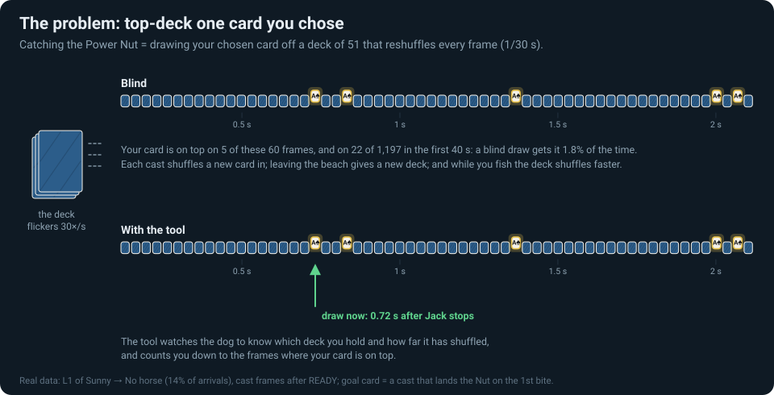

**Try it:** the site's **[deck page](https://nillows.github.io/HM64-RNG-Manipulations/deck.html)** (`deck.html`) lays out
52 cards in new deck order. Take one out, pick your goal card and stack the deck (seeded by the clock × the time you have
spent on the page). The 51 cards lie face down in a grid. Press **Start** when Jack stops at the pier, then **press and hold
the deck** (or Space) to cast: the moment you press is a game frame, and you get the real cast the lab recorded on that frame
of a real dog line (Sunny · No horse, casts up to 40 s after Jack stops, at the game's own speed). Each bite of that cast
lights one face-down card for 0.33 s, and the big card you hold glows with it: **the big card is your bobber** (Jack's cast
plays faintly on it, his rod dipping at each bite), so you watch one spot as you watch the float on the TV. **Let go while it
is lit** to catch it — your goal card when the bite is the Power Nut. Let go at any other time and the line comes back empty. One cast per attempt: *Try again* is a new arrival with
another dog line, and no cast in 40 s means Jack lies down. Tick *Use the tool* to see what knowing the frame and the bite
does. Tick *show RNG speed* to turn the 51 cards face up, dealt anew at every step of the game's random number: once per game
frame while Jack stands at the pier (the main loop's `rand()`, 30 a second), three times per frame while the line is in the
water waiting for a bite (the game rolls `getRandomNumberInRange(0, 400)`, a 1-in-401 bite check, every frame, and that function
calls `rand()` twice: 90 a second; the dog adds its own on top). The cards flicker, so it is off by default.

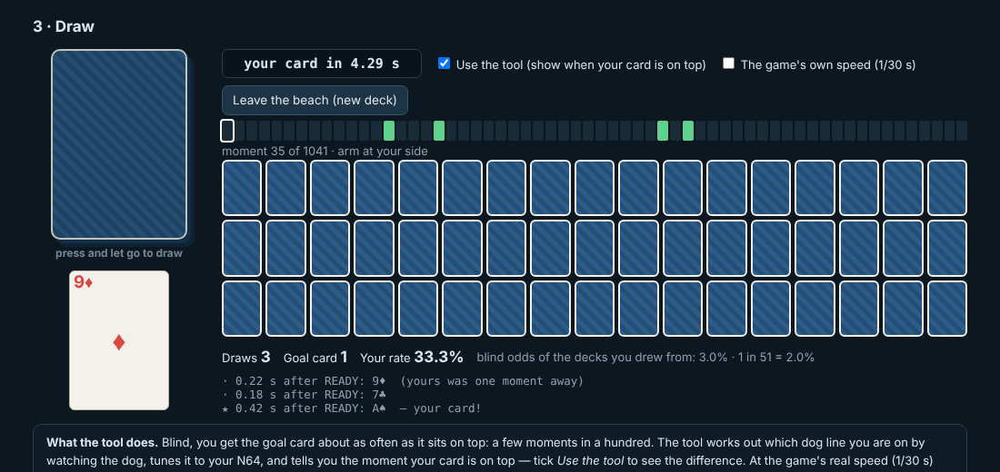

<sub><b>The deck page</b> with <i>Use the tool</i> ticked, the line in the water: bite 2 of this cast lights one of the 51
face-down cards for 0.33 s and the big card glows with Jack's rod dipping on it, and the tool says let go now (before the cast it counts you down to the frame to press on, with
a strip of the next cast frames: green = let go at the 1st bite, gold = hold the 1st and let go at the 2nd).</sub>

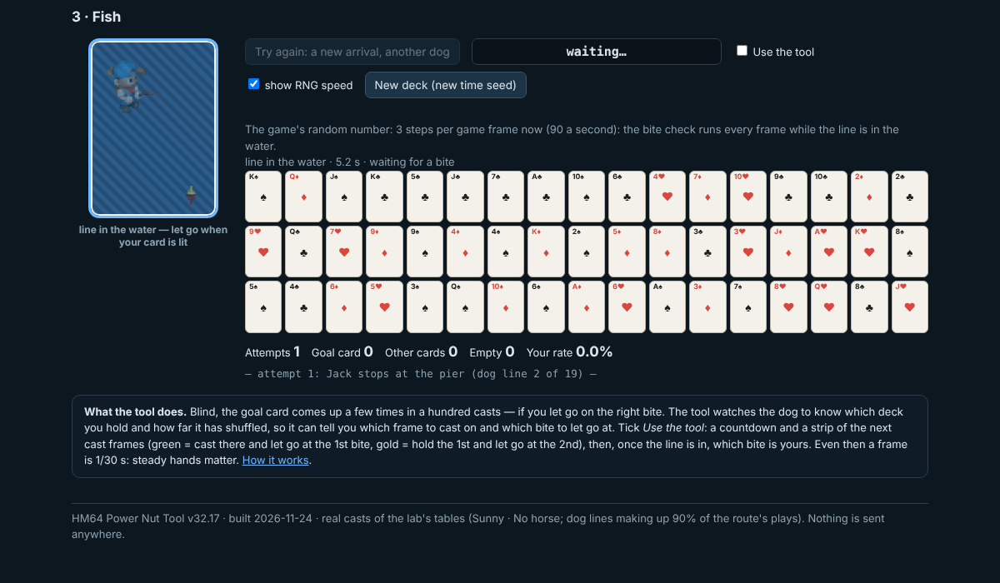

<sub><b>Show RNG speed</b>, the line in the water: the 51 cards face up, dealt anew at every step of the random number — 3 per
game frame now, 90 a second (1 per frame, 30 a second, while Jack stands at the pier).</sub>

---

## Contents
**What problem does it solve? [Top-decking one card](#the-problem-it-solves-top-decking-one-card).** **Only want a stopwatch? Start with [Optimal Blind Casting](#optimal-blind-casting).** **Want to try it first, with no
console? [Dog practice](#dog-practice-try-it-without-a-console).** **How can a dog tell you when to cast? [How it works: a
leaf in a forest](#how-it-works-a-leaf-in-a-forest).** **Where do the numbers come from? [How the odds are worked
out](#how-the-odds-are-worked-out).** **Your keys, timing and practice? [Settings](#settings-your-keys-timing-and-practice-in-one-place).** **Something wrong? The site's [Not working?](https://nillows.github.io/HM64-RNG-Manipulations/not-working.html) page.**

1. [Quick start](#1-quick-start)
   · [Settings: your keys, timing and practice in one place](#settings-your-keys-timing-and-practice-in-one-place)
2. [Setting up the game file](#2-setting-up-the-game-file)
3. [The route](#3-the-route)
4. [What the app starts with](#4-what-the-app-starts-with)
5. [Layer 1 — the histogram and its cast suggestion](#5-layer-1--the-histogram-and-its-cast-suggestion)
6. [Layer 2 — find your dog and tune it to your N64](#6-layer-2--find-your-dog-and-tune-it-to-your-n64)
7. [Layer 3 — Freestyle: choose your own cast](#7-layer-3--freestyle-choose-your-own-cast)
8. [Ending an attempt, results and reports](#8-ending-an-attempt-results-and-reports)
9. [Practice drills](#9-practice-drills)
10. [Every setting, explained](#10-every-setting-explained)
11. [Keys and feedback](#11-keys-and-feedback)

---

## 1. Quick start
1. Open the hub in a **desktop browser with a keyboard** (Chrome recommended for now), tick what is true of your file
   (nothing ticked = Sunny → No horse) and press **Lucky Timer**. A page is 24–38 MB and takes a few seconds to load.
2. Make the game file described in section 2 (or get a copy of one).
3. Nothing to set up: the page opens ready (section 4).
4. Play: walk the route (section 3) and **tap Space once the moment Jack stops at the end of the pier**. Click the dog
   card that matches your TV, tune it with **[ ]**, and cast on one of its bars (sections 6–7). Cast and reel on the
   controller; the keyboard is only for the tool.

Not working? Every tool page has a **Not working?** button in its footer: a short checklist, each item linked to its
answer on the site's [Not working?](https://nillows.github.io/HM64-RNG-Manipulations/not-working.html) page. The setup and the route of sections 2–3 are on the
[Guide](https://nillows.github.io/HM64-RNG-Manipulations/guide.html); the pictures of [How it works](#how-it-works-a-leaf-in-a-forest) have
[a page of their own](https://nillows.github.io/HM64-RNG-Manipulations/how-it-works.html) too.

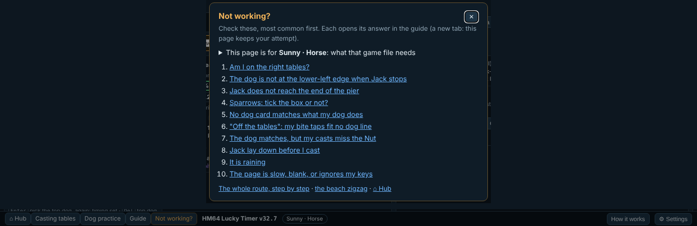

<sub><b>Not working?</b> on the Lucky Timer; the Casting tables and Dog practice have the same button. The fold at the top
lists what this page's game file needs; each line opens its answer on the Not working? page in a new tab, so the attempt on
the page is kept. <b>Guide</b> next to it opens the guide on this game file's setup.</sub>

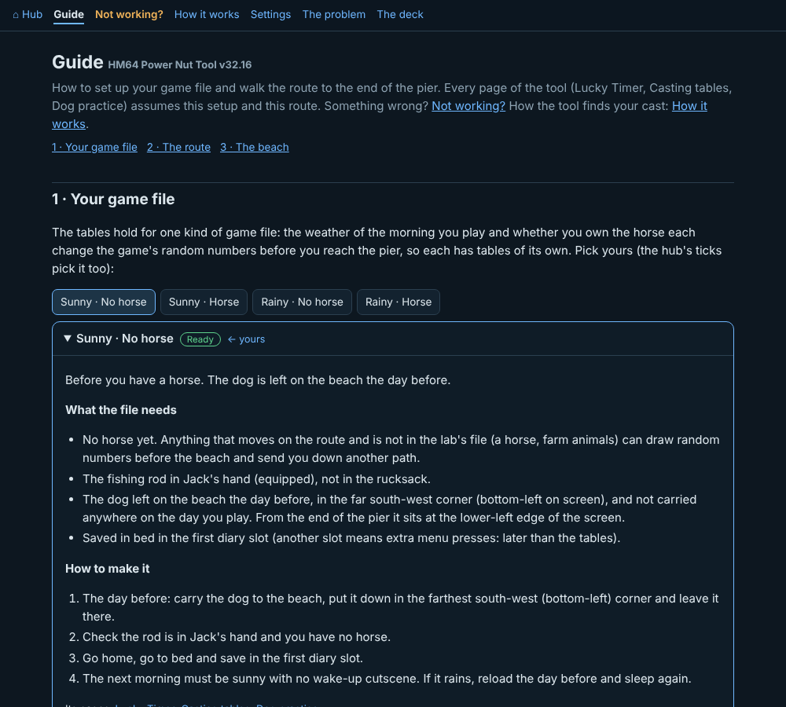

<sub><b>The guide page</b> (<code>guide.html</code>, linked from the hub and every tool page) opens on your game file: what it needs
and how to make it, then the route and the beach. Its top bar leads to the other two help pages.</sub>

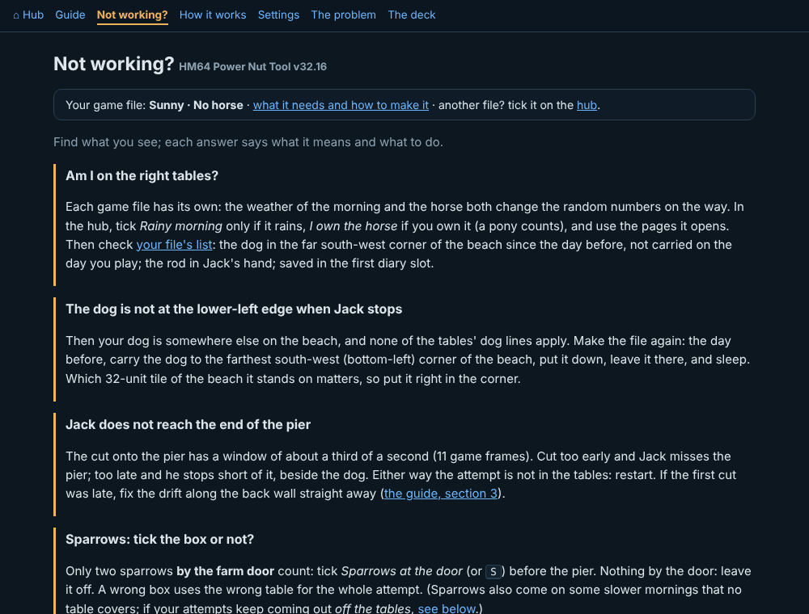

<sub><b>The Not working? page</b> (<code>not-working.html</code>) names the game file it is for (the one you ticked on the hub, or the
tool page you came from) and links back to its setup; one answer per problem, most common first. <b>How it works</b>
(<code>how-it-works.html</code>) is the pictures of the section below, with a line each.</sub>
No tool at all? [Optimal Blind Casting](#optimal-blind-casting) below tells you, from what the dog does in the first 10 s, when to cast.
No console to hand? [Dog practice](#dog-practice-try-it-without-a-console) lets you tune, read and fish real dog lines in the browser.

---

## Settings: your keys, timing and practice in one place
The site's **Settings** page (`settings.html`; the hub's *Settings* button, *Settings* in every tool page's footer) holds
everything about **you** that the pages use, so it is set once and shared: the Lucky Timer, the Casting tables and Dog
practice all read it and all add what they measure to it (the same records the Lucky Timer has always kept, so nothing
of yours is lost).

- **Your attempts:** one count for every page. Each Lucky Timer attempt started at the end of the pier (logged or not) and
  each whole attempt in Dog practice adds one; the count starts from the attempts already on record. The hub shows it on
  its Settings button.
- **Your timing:** the timing picture (each dot is something measured about you: left early, right late, top steady,
  bottom loose), the four numbers the tool uses (start taps, B press on CAST, bite taps, how much you vary) and **Set by
  hand**: start-tap delay (+ learn from your bite taps), cast-cue correction (your B-press habit), timing spread. What only
  a page with the dog tables can learn (the clock shift from your bite taps, how well your console's offset is known, where
  your casts landed) is shown as the Lucky Timer last worked it out. Dog practice's whole attempt measures your tap when
  Jack stops; after 5 of them it can set your start-tap delay.
- **Practice:** the Lucky Timer's two drills, same timings, same records. **Cast + bite practice**: press your start key on
  CAST (pulses at −1.5 / −1 / −0.5 s, optionally a moving cast line), keep holding, let go the instant the rod dips.
  **Bite practice**: hold, let go at the bite (or tap). Histograms, your median and spread, *Copy to my hand-set values*,
  *Forget*.
- **Your keys:** the start key, the dog's facing keys (arrows / W A S D), every animation key with its share of the dog's
  wait, the card-timing keys; the Lucky Timer's refusals (keys the tool itself uses).
- **Cues and the cast tap:** sound with the visual cues; the optional cast tap and its precision.
- **Your console:** the frame period (NTSC N64 = 33.430 ms; anything else gets a warning with a one-click fix) and the
  stock bite-tap delay.
- **Your data:** *Export to a file* / *Import from a file*.

**On the website** every page shares one store, and a change on the Settings page reaches an open Lucky Timer or Dog
practice tab at once. **A page opened from a folder on your computer** keeps its own store (the browser keeps each file
apart), so move your settings with a file: export on the Settings page, then on the local page click *⇅ Settings file* in
its footer and import it (or the other way round).

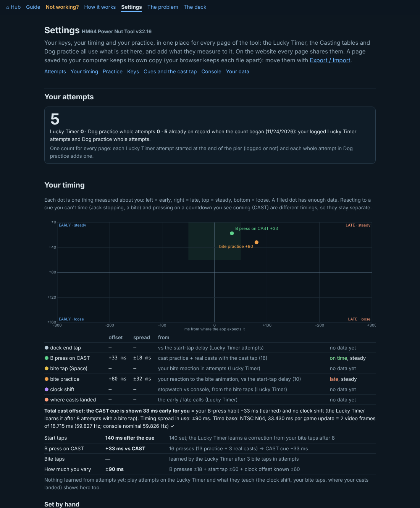

<sub><b>Settings</b>: one attempt count for every page, the timing picture and the four numbers the pages use, with what
the Lucky Timer last learned from attempts.</sub>

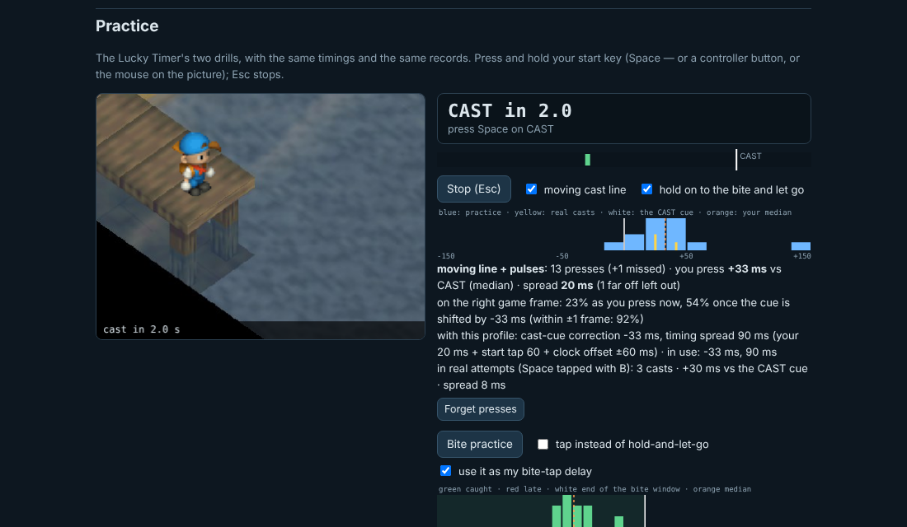

<sub><b>Cast + bite practice</b> on the Settings page: the countdown with the moving cast line, Jack on the READY screenshot, the
histogram of your presses (blue) and real casts (yellow) against the CAST cue.</sub>

---

## Optimal Blind Casting
No live tool needed, only a stopwatch and your eyes. Start the stopwatch the moment Jack stops at the end of the pier
(where you would tap Space, section 3.5) and watch the dog for 10 seconds. If it starts one of these, press **B at the
time shown — anywhere within half a second of it** — and let go of B as the line says.

- If you see **wiggle-bum** facing **↙ down-left** at **0.5–2 s**, cast at **62.4 s** for **28%** (1 in 3.6) — let go at the 1st bite · push ↘ at 33 s.
- If you see **flapper** facing **↙ down-left** at **4–6 s**, cast at **62.4 s** for **27%** (1 in 3.7) — let go at the 1st bite · push ↘ at 33 s.
- If you see **flapper** facing **↙ down-left** at **2–4 s**, cast at **22.2 s** for **12%** (1 in 8.3) — let go at the 1st bite.
- If you see **sit** facing **↗ up-right** at **8–10 s**, cast at **22.2 s** for **13%** (1 in 7.9) — let go at the 1st bite.
- If you see **rollover** facing **↙ down-left** at **8–10 s**, cast at **30.2 s** for **12%** (1 in 8.5) — hold the 1st bite, let go at the 2nd.
- If you see **smell** facing **→ right** at **2–4 s**, cast at **61.5 s** for **30%** (1 in 3.3) — let go at the 1st bite · push ↘ at 33 s.
- If you see **shoulder-sitting** facing **→ right** at **6–8 s**, cast at **61.5 s** for **30%** (1 in 3.3) — let go at the 1st bite · push ↘ at 33 s.
- If you see **run** facing **↘ down-right** at **2–4 s**, cast at **12.8 s** for **13%** (1 in 7.6) — hold the 1st bite, let go at the 2nd.
- If you see **walk** facing **↘ down-right** at **4–6 s**, cast at **12.8 s** for **13%** (1 in 7.6) — hold the 1st bite, let go at the 2nd.
- If you see **none of these** by 10 s, cast at **63.0 s** for **8.7%** (1 in 12) — let go at the 1st bite · push ↘ at 33 s.
- Not watching the dog at all: cast at **63.0 s** for **10%** (1 in 9.8) — let go at the 1st bite · push ↘ at 33 s.

**Push ↘ at 33 s:** a cast after 40 s needs one push of the stick **down-right** at about 33 s, or Jack lies down at
40 s (section 3.6). Never push after you have cast. **Hold the 1st bite, let go at the 2nd** = keep B held through the
first bite and let go when the second one comes.

The odds are the share of the lab's arrivals on this route (the file in section 2, no sparrows at the door) that show
the sign and land the Power Nut with B pressed anywhere in that second, every frame of the second alike (more in
[How the odds are worked out](#how-the-odds-are-worked-out)); 1 in 51 (2%) is the game's base chance per catch.
Emulator data. With **sparrows at the door** (section 3.2) the dog lines are different: use the app's list with the
Sparrows box ticked.

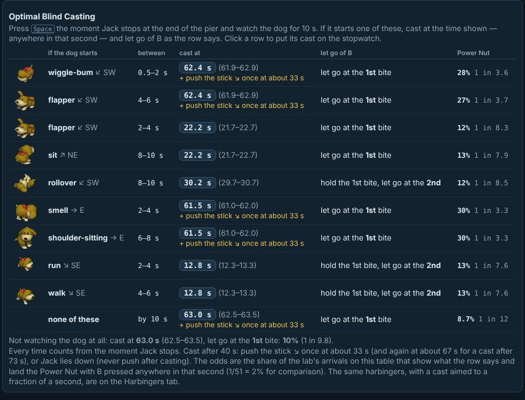

<sub><b>The same list in the app</b>: the first tab of the <b>Casting tables</b> page (hub → Sunny → No horse). Space starts its stopwatch when
Jack stops; click a row and it counts down to that cast. The Harbingers tab has the same signs with a cast aimed to a
fraction of a second.</sub>

**What you cast into (v32.2).** Every row has a small picture of its window: the cast histogram of that row's arrivals
from 2 s before the window to 2 s after, one column per game frame (1/30 s). Green = the Nut on the 1st bite, gold =
the Nut on the 2nd bite if you hold the 1st, the blue band = the second you press B in, the white line = the row's odds.
Click it for the close-up: the same histogram large, with a readout under the mouse, and below it every dog line of the
row (heaviest first) with its own Nut frames. A dense block of tall bars across the window means most presses in that
second land on a Nut frame; a few tall spikes with gaps (the "run" / "walk" rows) mean the odds come from single frames,
so the second you press in matters more. Each game file's page draws its own, from its own tables.

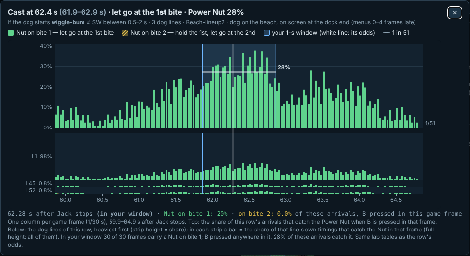

<sub><b>The close-up</b> of the wiggle-bum row (Sunny → No horse): cast anywhere in 61.9–62.9 s, let go at the 1st bite, 28%.</sub>

**Dig into a window (v32.4).** In the close-up, **click a candle**: the chart keeps only the arrivals that make up that
candle (the dog lines, at the timings, that have a Nut in that frame) and shows where else *their* Nut frames are — its
neighbours show the double or triple it sits in, and every candle those arrivals can't reach disappears, as on the Lucky
Timer's freestyle once it knows your dog. The clicked candle itself reads **100% by definition** (only the arrivals with a
Nut there are kept, like filtering a class to the students who got question 5 right: question 5 is then 100%); the
chart labels it so, with the share of the row it held. The news is in the *other* candles. The list under the chart shows each line's
share of the row, how many points of the window's odds it adds, its odds if you are on it, and its runs of Nut frames.
<kbd>←</kbd> <kbd>→</kbd> step one game frame, <kbd>Esc</kbd> clears (a second <kbd>Esc</kbd> closes). Tick **keep every
candle when I click** for the other view: every candle stays and the dog lines without a Nut there dim.

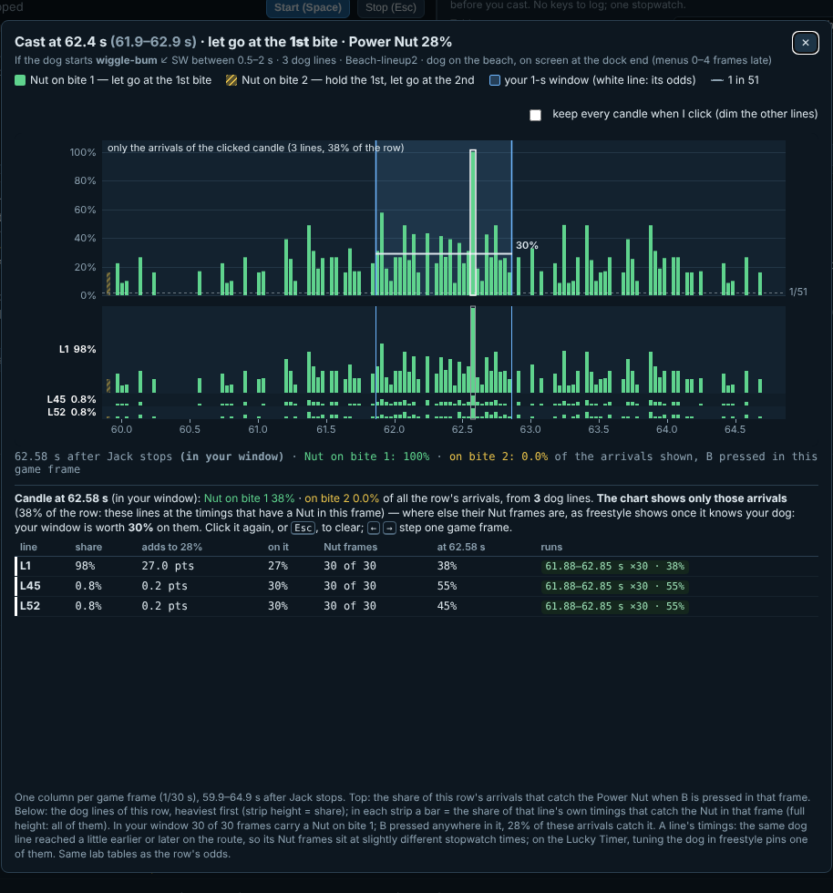

**Click a line** (in the list or its label on the left): the chart shows only that line (with the box ticked: its part
of every candle is drawn white), and its **timings** are listed. A timing is the same dog line reached a little earlier or later along the route, so at your stop its dog
is a few frames ahead or behind and its Nut frames move with it. Each timing on its own has exact Nut frames — single
frames, doubles, triples — the same groups freestyle shows on the Lucky Timer once the dog is tuned. Click a timing and the
chart shows only its exact Nut frames, each at 100% (▲ and white outlines mark them too). Blind casting cannot know your timing, which is why a line's bars
in the strip are fractions; the timings show what they are made of.

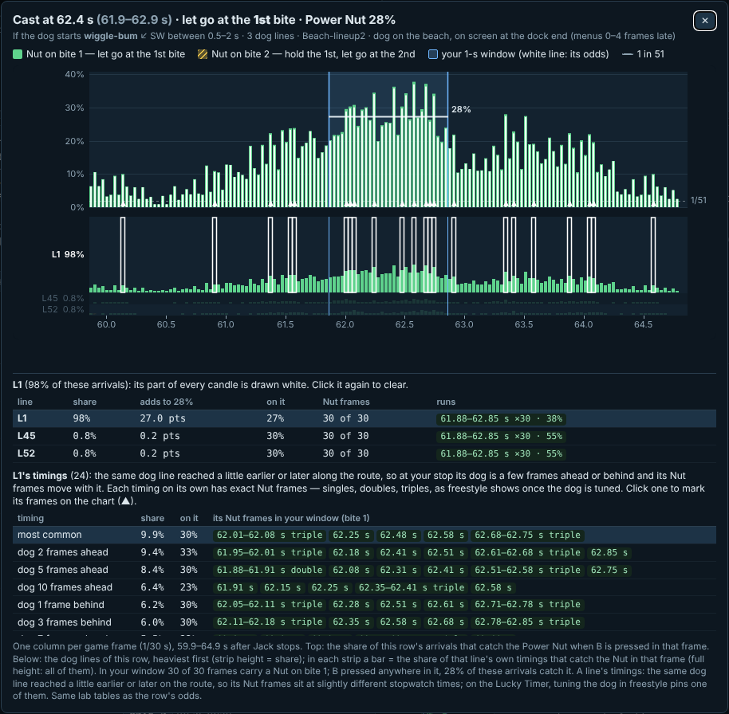

**Try it: change the inputs (v32.5).** The close-up's **Try it** button opens a test bench for the row's number. Change
**your press** — anywhere in a window of any width, or aimed at a moment with a spread (a bell curve, ±0–300 ms) — slide
**where** you press, pick **which bite** you let go at, and tick off **dog lines** (what watching the dog does: it rules
lines out). The candles and the odds follow live, and a line under the controls says how the number is made: each
candle = the sum, over the lines that count, of the line's share × the share of its timings with a Nut in that frame; the
odds = those candles averaged over the window, or weighted by the bell curve around the aim (the white line shows that
number for every aim). With the row's own inputs it gives the row's odds exactly.

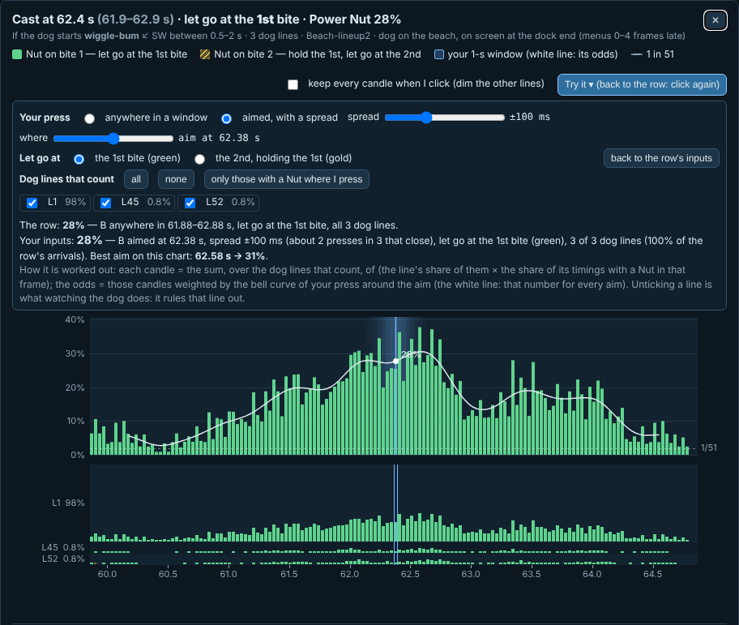

<sub><b>Try it</b> on the wiggle-bum row: aimed at 62.38 s with a ±100 ms spread instead of "anywhere in the second". The
blue glow is the press's bell curve, the white line the odds for every aim (best aim on this chart: 62.58 s, 31%).</sub>

---

## How it works: a leaf in a forest
The tool's job is to find one moment to press B among billions of possible game states. Here is how, as a picture: a
forest. Every picture is drawn from the lab's own records ([how they are made](#how-the-pictures-are-made)).

**The forest.** Every random thing in the game — the dog's next move, when a fish bites, what it is — comes from one number,
the random number generator. Every time anything asks for a random number, that number steps to a new value, and it can be
any of about 4.3 billion values, from −2,147,483,648 to +2,147,483,647. Picture all its possible histories as a forest: as
wide as all those values, and as tall as the game has been running. The cast that lands the Power Nut is a single leaf, on a
single low branch of one tree, before that branch disappears into the canopy — where branches that started apart grow
into each other (two different routes can reach the very same game state).

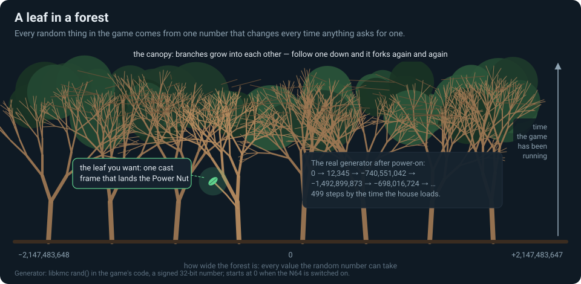

**Why not search down from the leaf?** You could start at a leaf and follow its branch down to find its trunk. But at every
fork it could have come either way, all the way down through the canopy of time to the forest floor, and even then you would
end up with a handful of possible trunks and how likely each is — odds, not an answer. The picture does it for real: the
most common dog line of Sunny → Horse (L1), traced back through every play the lab made, comes from all 7 menu timings
(2%, 13%, 18%, 24%, 34%, 6%, 3%).

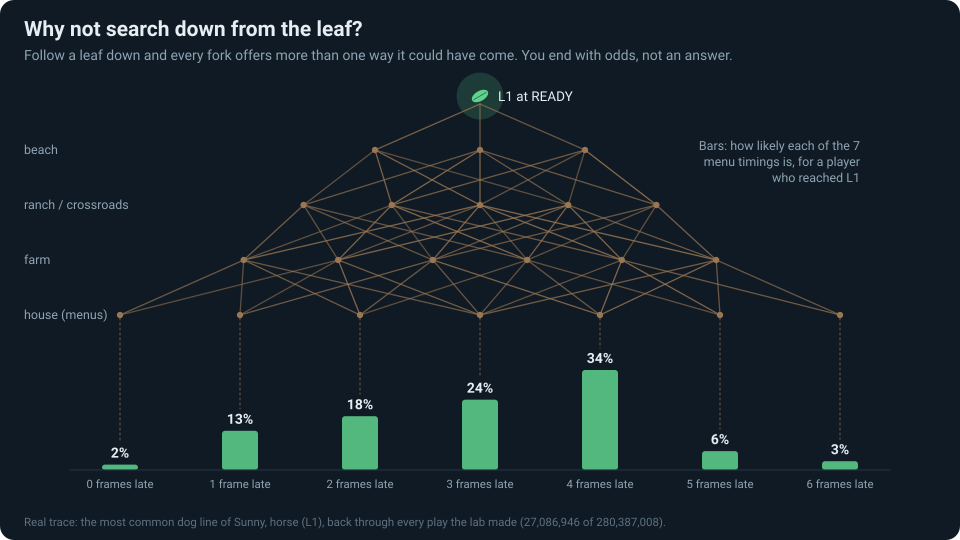

**Why branches merge.** Branches grow into each other for the same reason that 1 + 2 = 3 and 2 + 1 = 3: different
circumstances can lead to the same answer. Here the answer is a pair — the random number's value and the dog's state
(where it is and what it is doing). The random number can only take about 4.3 billion values, and the dog only so many
states at each of those moments, so the canopy is huge but not infinite, and sooner or later two different routes land on
exactly the same pair. There are endless ways to write a sum that comes to 3, and once you know the answer is 3 you can
forget how it was written; in the same way, once two routes reach the same value with the same dog, everything after
that is the same (the lab checks it: casts from different routes of one dog line catch the same thing), so the tool keeps
one branch and ignores all the strange ways of getting there. The one thing that can still differ is *when* each route
got there: the same pair, reached at a different moment — the same branch, entered higher or lower. That is why a dog
line comes in at several timings, and why the search runs from the bottom up: on the way up every merge removes
branches, on the way down every fork adds them. The picture shows real merges on Sunny → Horse: plays with menus 0, 3 and
5 frames late all become L1, joining its path at +14, +19 and +33 frames (the most common moment for each).

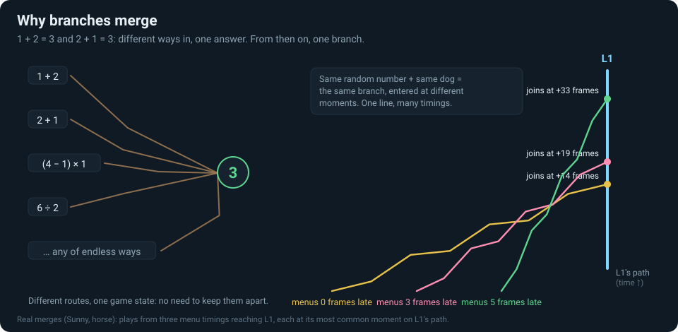

**So the tool grows the forest from the bottom up.** Switching the N64 on sets the number to 0 on every console: one shared
seed that every forest grows from. The title screen and the menus draw 499 numbers by the time the house
loads on the fastest menus. **The first exploit:** the tables only cover menus 0 to 6 game frames slower than the fastest,
so the trunk splits into a crown of just **7 main branches** — the house loads at draw 499 to 505,
one more draw for each frame late. Slower menus grow 9 more branches that the tables leave out, and
that is what keeps the forest small enough to grow completely. Two of the 7 carry an identifier: menus 5 or 6 frames late put
**two sparrows by the farm door** ([3.2](#32-sparrows-at-the-door)), and those two branches have their own table. (On a
sunny morning: no sparrows come out in the rain, so the rainy tables keep all 7 branches in one.)

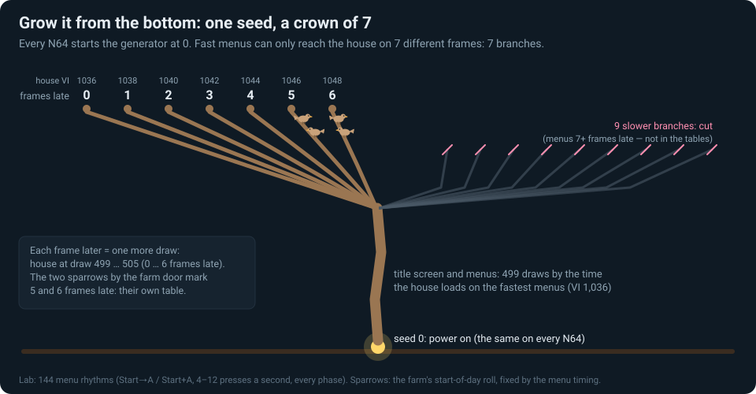

**Sunlight (the forest's sunlight — not the game's weather).** In the forest picture, sunlight is the base drift of the
random number: how many numbers a place draws each frame on its own, with nothing extra asking for any, as you travel to
READY at the end of the pier. Each screen shines its own amount of it on the canopy of our ever-growing forest. Sunlight
does not decide how fast a branch grows taller — height is time, and every branch reaches READY at the same height — but it
changes *how* the branch grows in that time: an hour of sunlight changes how a plant grows during that hour, not how old the
plant is. What counts is each place's own drift and how long you stand under it. On a sunny morning the farm, the
crossroads and the ranch drift about one number per game frame; the horse file draws a few more (2 on the farm, 4 at the
crossroads, 4 on the ranch) although the horse never comes on screen. And this is where the two meanings of "sun" cross:
a *rainy* morning gives the forest far *more* sunlight, because outdoors the rain draws 13 to 19 numbers a frame — READY
comes at draw 10,593 instead of 1,259. Same route, same clock, very differently grown branches: that is why every game file
needs its own tables.

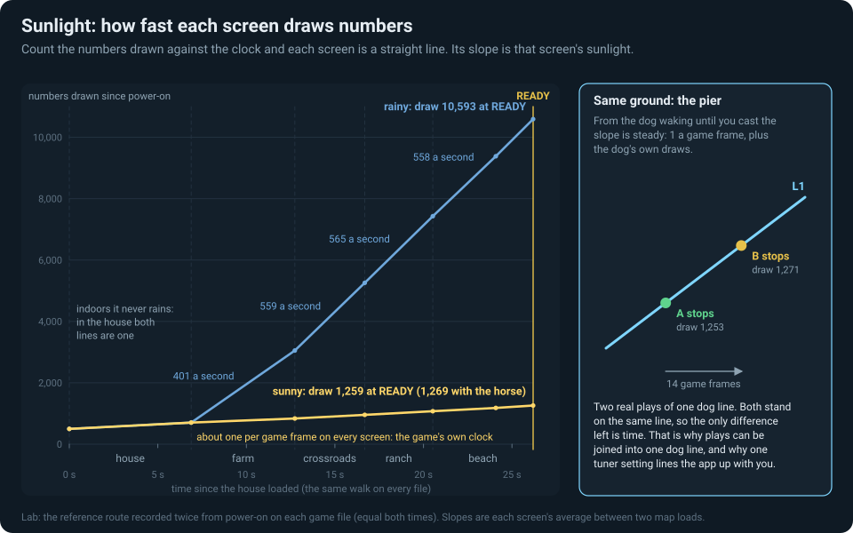

**Three crowns on each branch.** Nobody walks frame-perfect, so the tables also cover a little slack after the menus: the
turns in the house (up to 4 game frames), the turn at the crossroads (up to 3) and the beach —
your first step (up to 15), the first cut (1) and the cut onto the pier (an
11-frame window). That is 34 game frames, about 1.1 s, peppered over three places.
Each of the 7 branches forks again at each place, but every fork still grows to the same height: READY, Jack stopped at the
end of the pier. Branches from different crowns grow into each other: counted over all 7 there are 19 farm,
54 ranch and 50 beach states, not 33 /
116 / 114.

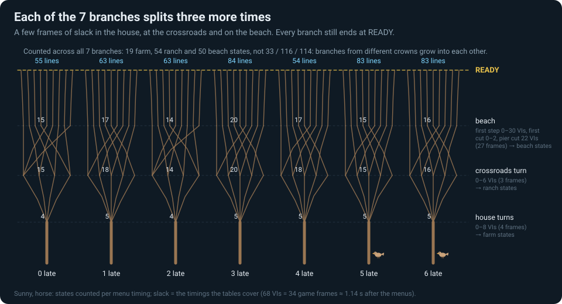

**The pier moment: group the branches by shape.** Sorting branches by shape only works once the forest's sunlight stops
changing. On the way to the pier that light is yours: every turn, wait and cut decides how long you stand under each
screen's drift and when the dog wakes, so two branches that look alike can still be pushed apart. From the moment the dog
wakes (Jack at the bottom of the back wall) nothing Jack does touches the random numbers any more, and standing at the end
of the pier the light on the forest is as steady as it gets: the base drift is exactly one number per game frame (the
game's own clock), plus the draws the dog makes — and those belong to the branch itself, decided by the dog's state. From then until you cast, a branch is fully described by two things: the
random number's value **x** and the dog's state **y** (where it is, what it is doing, the timer on what it is doing). With
the light steady, (x, y) has exactly one future: the next frame's x and y follow from it, then the next, and so on — the
shape could not be any other way. So two branches that show the same (x, y) are the same branch, and one that reaches that
(x, y) a few frames later is the same shape, offset in time: one causal future, and every copy collapses onto it.

Written as **key : value** — the random number : the dog (what it is doing, which way it faces, the timer on what it is
doing) — real pairs from Sunny → Horse look like this (in every one the dog still stands where it was left):

```
  569421077: standing, facing 0, timer 2    L1 as Jack stops (draw 1,253)
  -76265430: standing, facing 0, timer 1    L1 1 frame later (draw 1,254: the clock)
 -117721573: standing, facing 0, timer 0    L1 2 frames later (draw 1,255)
 -169427722: standing, facing 0, timer 10   L1 3 frames later (draw 1,258: the clock + 2 for the dog's choice)
 -117721573: barking, facing 0, timer 2     L2 as Jack stops (draw 1,255)
  297534865: digging, facing 0, timer 10    L3 as Jack stops (draw 1,257)
```

A key can only be one of 4,294,967,296 numbers, and a value one of the dog's couple of dozen actions × 8 facings × its timer
(× its spot): a huge table, but a finite one, and every branch lives inside it. Two rows above share the key
-117721573 but not the value — L1 2 frames after it stops, with the dog standing, and L2 as it stops, with
the dog barking: two different branches. A key and a value together make a branch, and the same pair always has the
same future.

On a rainy morning the light never quite steadies: the raindrops keep drawing numbers as they start and stop, so the rain
is a third part of the pair. At READY that changed nothing the lab could find (casts re-made from other plays of the same line
gave the same bites every time: 178 checks on the horse file, 223 without), but after a cast two runs can meet on the same
key and value with different rain and part again. That happened at about 1 in 65 of the bite states the rainy runs saw more than
once (none on the sunny runs), so since v32.18 the cast pack compares the whole recorded future of every bite and keeps
those apart: every one of the 325,948 rainy casts it was built from reads back exactly.

The picture shows it with two real plays of L1 on Sunny → Horse. A cut onto the pier early and stopped with
x = 569,421,077 (draw 1,253 since power-on). B came by a different route and stopped 14 frames
later, at draw 1,271: 14 frames before it stopped, while Jack was still walking along the pier, B passed
through exactly A's pair (the first row above), and from there the two are one branch.

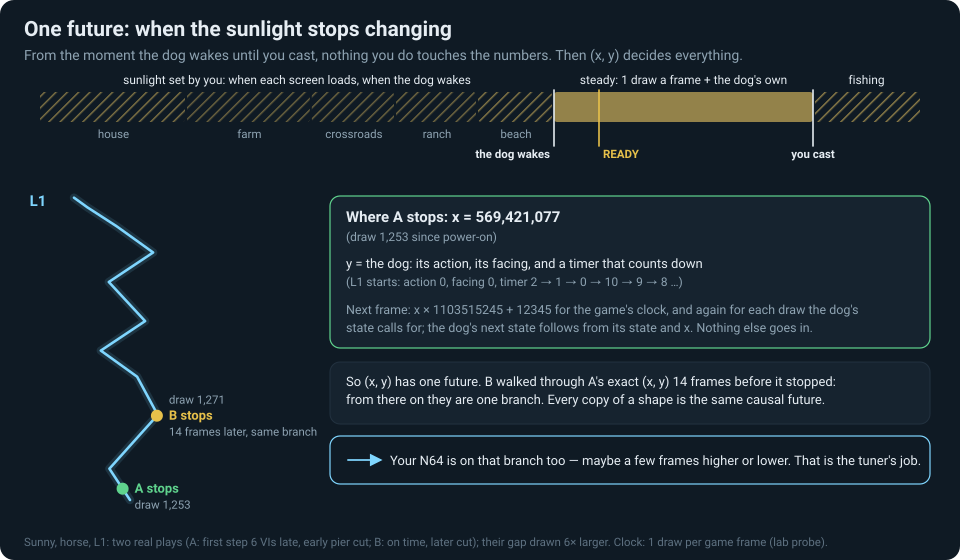

That is the test the lab runs at READY, and it is why so few branches are left: on Sunny → Horse the lab's
280,387,008 ways to play the route merge into 35,200 different plays on the beach and
1,952 different arrivals at READY. Searching them all would be hopeless — but most of them are **the same
branch, started a few frames later**: the same dog doing the same things, offset in time. Keep one of each and
1,952 arrivals become **156 dog lines** (92% of the arrivals were copies). Fold in the
lines that become the same dog after a few seconds (sister lines) and a normal morning has **21 shapes** to tell
apart, a sparrow morning 16. That is the comparison that cut the dogs down in earlier versions — and it sets up the tuner
below: your N64 is on one of these branches too, perhaps a few frames higher or lower than the tables' copy.

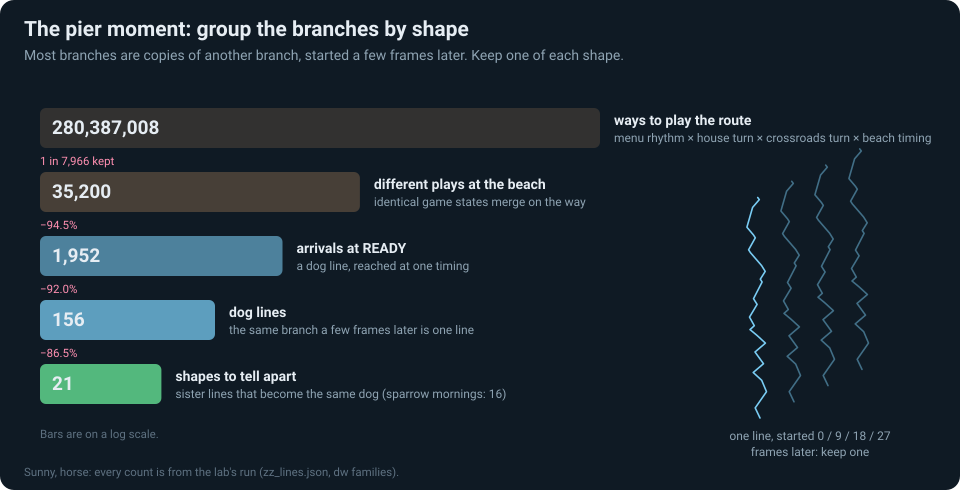

**The leaves: only a cast grows them.** The branch you watch before you cast has no leaves at all. A leaf needs a cast:
casting is the moment the branch bends, because the line in the water brings sunlight of its own (it draws random numbers of
its own), and the branch that grows from that bend is the one that decides when a fish bites and what it is. So the leaves are
not hanging on the branch ahead of you, waiting — the cast moment you choose decides whether the branch it starts will grow
one.

The picture shows it on L1 of Sunny → No horse, with two real casts one game frame apart. In all three rows the branch is
the same up to 16.23 s. With no cast it never grows a leaf. A cast at 16.23 s bends it into a branch whose
first bite, at 37.9 s, is **the Power Nut**. A cast one game frame later, at 16.26 s, bends it into another
branch whose first bite, at 28.4 s, is a small fish.

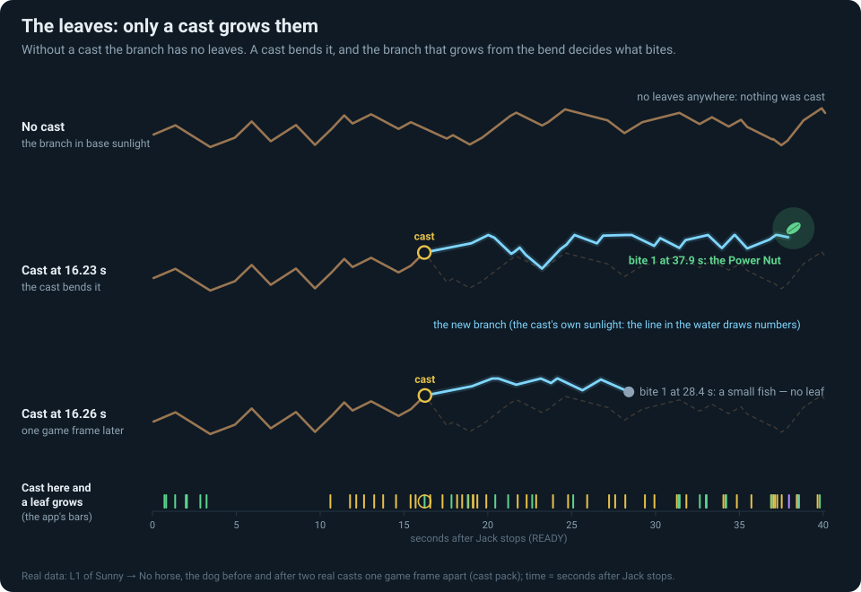

Mark every cast moment that grows a leaf and you get the strip at the bottom of the picture — **green** = the Nut on the first
bite, **gold** = on the second (hold the first), **purple** = a later bite; L1 has 22 green, 43 gold and 2 purple in its
first 40 s — and that strip is what the app's bars show. You don't cast *at* a leaf: you cast at the moment that grows one,
like an interception.

**Describing your dog describes your branch.** What the dog does after Jack stops is the shape of your branch, and each move
you key narrows it down. On Sunny → No horse, after the dog's first move 6 lines still have L1's
shape, after two moves 2, after four only L1. With enough of the dog seen, the tool knows which
branch you are on and which of its cast moments grow leaves.

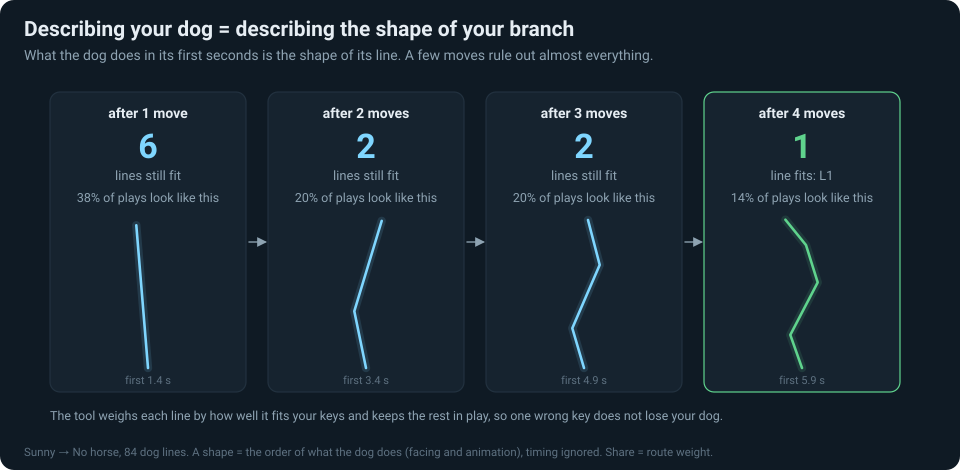

**But not how tall your tree has grown: the tuner.** Your N64 can be a few frames ahead of or behind the tables' copy of the
same branch (each line comes in at about 10 timings). The tuner (<kbd>[</kbd> <kbd>]</kbd>, one game frame per press) slides the
app's branch up or down until your dog turns at the very moment the card does — and then the cast moments that grow leaves are at
your N64's height too.
Because a shape has only one causal future (the pier moment above), the height is the only thing that can still differ:
match the dog's turns and everything after them matches, including which cast moments grow leaves.

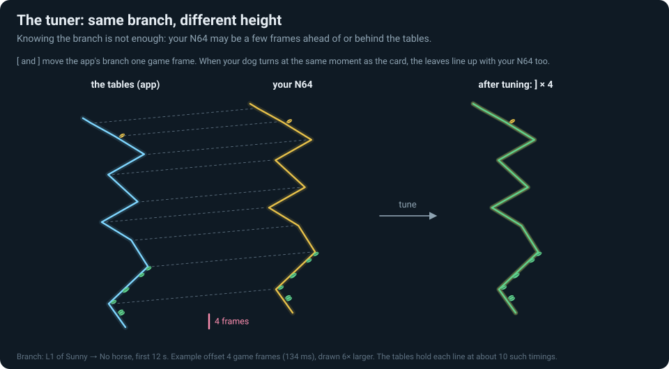

**L1 across game files: two cubes.** Every game file that changes the random numbers before the pier needs tables of its
own: the weather, the horse, and later a marriage and a baby. Three yes / no questions make a cube — horse × married ×
baby, 8 corners — and the weather is a fourth, so there are two cubes, one sunny and one rainy: 16 game files in all.
Each corner shows its L1 (the most common dog line) once its tables are in. Today four corners are filled. Sunny with and
without the horse share the **same L1 branch**: every move of the dog and every leaf, 3 game frames earlier on the horse
file. Rainy with and without the horse share one L1 too, and **at the same moment**: in the rain the horse's two extra numbers
on the farm get swallowed. Each raindrop that is not falling rolls the dice every frame (one in five starts it) and a drop that
starts rolls twice more for where it lands, so the rain reads the numbers in chunks of changing size; two runs that are two
numbers apart soon fall into step, like the Kruskal count card trick, where two people counting through one deck from
different starting cards end up on the same card. That happens on most paths, not on all: about 85% of the rainy horse
file's plays end on a dog line the no-horse file also has, at the same moment, 7% on one a few frames apart and the rest
elsewhere, so each rainy file still has its own tables. The rainy L1 holds only 5% of the plays (sunny: 11–14%): rain spreads the plays over more lines
(20 lines hold half of them, 50 hold 90%). The married and baby corners come later. The cubes are only a picture: in the hub
you still just tick what is true of your file.

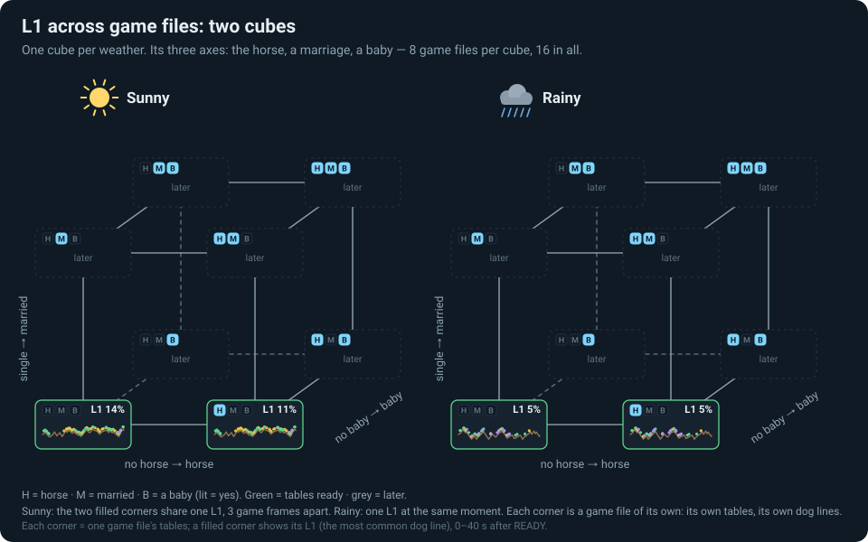

<a id="how-the-pictures-are-made"></a>**How the pictures are made.** `tools/forest_facts.py` reads the lab's runs (the stages
of a dog-watch run, the reference route of each game file, the dog lines and casts of each table) into one facts file, and
`tools/forest_svg.py` draws every picture from it — trees grown from the game's own generator, a dog line drawn as a branch
with a kink at every change in what the dog does. When new tables come in (married and a baby next), the same two
commands redraw them with the new numbers.

---

## How the odds are worked out
Plain English first; every percentage on every page comes from these steps.

**1. One random number generator, acted out by the dog.** Every random thing in the game — the dog's next move, when a
fish bites, what it is — comes from one random number generator. The dog draws from it all the time, so what it does on
the beach is a readout of where the generator is. The lab runs the real game in an emulator, so it can replay any moment
exactly and record what happens.

**2. The lab plays your route thousands of ways — the weights.** Nobody plays frame-perfect, so the lab played the route
the way a good player might, in every combination: mashing the menus at 5 to 15 presses a second (every rhythm), turning in
the house and at the crossroads at any moment that still reaches the next screen within a few frames of the fastest,
taking the first beach cut on its frame or the next, starting on the beach up to half a second late, and cutting onto the pier anywhere across it. On Sunny → No
horse that comes to 30,976 different plays on the beach, each standing for its share of every menu rhythm and turn that leads to it. Each play ends on one **dog line** (one path of the generator, which the dog acts out) reached
at one **timing** (the same line a few frames earlier or later). That pair is an **arrival**. Every choice counts as equally
likely within its window, so an arrival's **weight** is simply the share of all those plays that reach it.
Picture a pachinko machine: each turn you take a frame early or late is a pin, the dog lines are the cups at the bottom, and
a line's weight is how full its cup gets. On Sunny → No horse there are 84 dog lines; the most common holds 14% of the plays,
6 lines hold half of them, 19 hold 90%, and a line comes in about 10 timings.
- The weights are not measured on real players. If you always mash at the same speed, some lines come up more for you
  than for "a good player"; the Lucky Timer learns that from your bite taps (L5 → *Your dog lines*).
- Plays slower than these windows are not in the tables at all; the tool calls such attempts **off the tables**. The
  sparrow mornings (menus 5–6 frames late, section 3.2) are a separate set of plays with their own table on a sunny
  morning; the rainy tables hold menus 0–6 frames late in one (no sparrows in the rain).
- Rainy mornings: 8,448 plays on the beach and 99 dog lines without the horse, 5,632 plays and 68 lines with it; the most
  common line holds 5%, 20 lines hold half the plays and 50 hold 90%.

**3. Every cast frame has a known outcome.** For every dog line and every cast frame (one per 1/30 s) up to 120 s after
Jack stops, the lab recorded every bite and what it catches if you let go there — about 89,000 casts for Sunny → No horse.
So once the line and the timing are known, each frame is a plain yes or no for the Power Nut: on the 1st bite (**green**), or
on the 2nd if you hold the 1st (**gold**).

**4. A bar is a share.** When the tool does not know your line, the bar (or candle) for one frame is the weighted share
of the arrivals still in play whose cast on that frame lands the Nut. "28%" means: of every way a player who saw this could
have got here, 28 in 100 (by weight) catch the Nut with a cast on that frame.

**5. Your press is never exact.** The odds of a cast blur those bars with your press, like aiming a dart: the board is the
bars, the spread is your hand. An aimed cast (Lucky Timer, the Dog reference's casts) uses a bell curve with the spread you
set: ±150 ms means about 2 presses in 3 land within 150 ms of the aim. A blind window ("anywhere in that second") averages
the 30 frames of the second, each alike.

**6. Watching the dog rules arrivals out.** Seeing a sign keeps only the arrivals whose dog shows it — that is all an
Optimal Blind Casting row is. The Lucky Timer's dog-watch keys work softly: each key multiplies every line by how well it
fits (a key the line's dog does not show ×0.02, a turn of its dog you did not key ×0.1), then everything is scaled back to
100%. That is Bayes' rule — weight before × fit = weight after — and it is exactly the % on a dog card.

**7. Knowing the dog leaves only your hands.** With the right line, tuned to the right frame, nothing is averaged any
more: the bars are yes or no. What is left is your press: a double (two neighbouring Nut frames, 67 ms) is worth about
**29%** with a spread of ±150 ms and about **47%** at ±60 ms. Steady hands are worth more than anything else.

**8. The yardstick.** 1 in 51 (2%) is the game's base chance per catch. Everything here is emulator data, checked frame by
frame against the game, not measured on a console; the lab also played simulated runners through the real app against the
emulator, and the odds shown were the odds they got.

See it move: **Casting tables → click a picture → Try it**, or the **Dog practice** page below.

---

## Dog practice: try it without a console
A README cannot run anything, so the test area is its own page on the site: **hub → your game file → Dog practice**
(`dog-practice_<file>.html`, about 6 MB, works offline like the others). Every dog it plays is a real dog line of that game
file, drawn by how often the route reaches it (its weight), at a real timing — or the one line you pick under **Dog**. The
"TV" shows the end of the pier with Jack, and the dog in an inset (on your TV it sits at the lower-left edge). Three drills:

- **1 · Tune the dog.** The dog card plays the same line as the TV, at the tool's guess of your timing: your Space tap off
  by up to 150 ms, and the line reached a few frames earlier or later than usual — just as on the Lucky Timer after you pick
  a dog. Step it with your tuning keys until it turns at the very moment the TV dog does, then press **Enter**. The result:
  how many game frames off you were, and what that does to the line's next Nut casts (one frame off misses every single
  frame; a double forgives one frame on one side). **TV speed** ½× and ¼× slow the TV down while you learn what "in
  step" looks like.
- **2 · Read the dog.** Key what you see with your dog-watch keys — the facing whenever it turns (two keys at once = a
  diagonal), long animations on their keys — and watch the cards re-weight with the Lucky Timer's own matcher. When the
  top card is your dog, press **Enter** (or click the one that is). Right or wrong comes back with how sure the tool was
  when you picked.
- **3 · Whole attempt.** Tap your start key the moment Jack stops, read the dog, **Enter** for the top card, tune it,
  **Enter** again when it is in step. Its Nut frames scroll under the TV with a countdown to the next double; **hold** your
  start key on one to cast (here it is your B button, as the Lucky Timer reads a held Space) and **let go** when the float
  bites — the 1st bite for green, the 2nd for gold. The catch is the lab's record of the exact frame you cast on.

**Your keys.** The page uses the keys set on the [Settings](#settings-your-keys-timing-and-practice-in-one-place) page
(facing on arrows or W A S D, your animation keys, your tuning keys, your start key, your reaction at READY; on the website
every page shares them; *change them in Settings* next to the key list). A whole attempt adds one to the shared attempt
count, your tap when Jack stops is kept as a measure of your start-tap delay, and your release at a bite as a bite
reaction (the same records as bite practice). A page saved to your computer keeps its own copy: the footer's
*⇅ Settings file* moves them through a file. Keys are matched by
where they sit on the keyboard, like the Lucky Timer's, and their labels follow your layout (AZERTY, QWERTZ, …) where the
browser tells it, or once you have typed the key on the site. Your results (last 30 of each drill) stay in your browser.

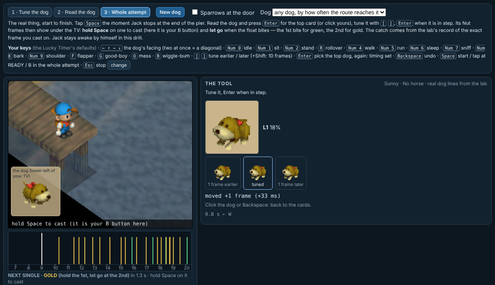

<sub><b>Whole attempt</b> (Sunny → No horse): Space tapped at READY, Enter took the top card (L1, 15%), the three frames
below it tune it; under the TV the dog's own Nut frames scroll by with the countdown "NEXT SINGLE · GOLD in 4.3 s".</sub>

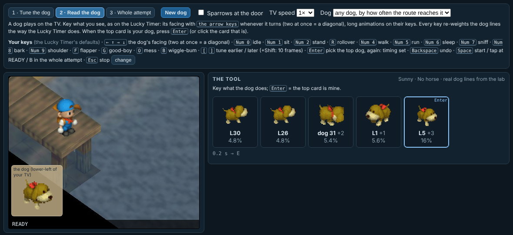

<sub><b>Read the dog</b>: one arrow (↙) keyed; the most likely card (L1, 20%) sits on the right with its <kbd>Enter</kbd> tag.</sub>

---

## 2. Setting up the game file
This is the file for **Sunny → No horse** in the hub. **Sunny → Horse** is the same file with the horse, and **Rainy →
No horse** / **Rainy → Horse** the same files on a rainy morning (see below); other game files get their own tables and
their own list there.

The tables work on any morning that starts the game in the same position as the lab's file. If yours doesn't, the
tool's dog lines will not match your game.

**What your file needs:**
- **A sunny morning with no cutscene when you wake up.** Any such day works.
- **No horse yet.** Anything that moves on the route and is not in the lab's file (a horse, farm animals) can draw random
  numbers before the beach and send you down a different path.
- **The fishing rod in Jack's hand** (equipped), not in the rucksack. Without it, B does nothing at the pier.
- **The dog left on the beach, in the far south-west corner** (bottom-left on screen), not carried anywhere on the
  day you play. From the end of the pier it sits at the lower-left edge of the screen.

**How to make it:**
1. The day before: take the dog to the beach, put it down in the farthest south-west (bottom-left) corner, and leave
   it there.
2. Make sure the rod is in Jack's hand and you have no horse.
3. Go home, go to bed and save in the diary, in the **first diary slot** (the lab's file is there; another slot needs
   extra menu presses, which makes you later than the tables).
4. The next morning must be sunny, with no cutscene when you wake up. If it rains, tick **Rainy morning** on the hub and
   use the rainy pages (the same file, below), or reload the day before and try again.

**With a horse (Sunny → Horse).** The same file and the same route, with two differences. A file with the horse draws a
few more random numbers on the way (2 more on the farm, 4 at the crossroads, 4 on the ranch) although the horse never comes
on screen, so it needs the horse tables, not the no-horse ones. And the horse must stay out of sight: leave it on the farm far from the house door, where it never
comes on screen while Jack walks from the door to the farm exit (a horse on screen draws more random numbers and can
get in the way). The lab's file has the pony, not yet grown; a grown horse has not been tested.

**On a rainy morning (Rainy → No horse, Rainy → Horse).** The same file and the same route on a morning when it rains: tick
**Rainy morning** on the hub. Outdoors the rain draws 13 to 19 random numbers a frame (READY comes at draw 10,593 instead of
1,259), so the rainy tables are other dog lines, and the sunny pages are wrong on a rainy morning (and the other way round).
No sparrows come to the farm in the rain, so nothing tells 0–4 from 5–6 frames late: the rainy pages have one table for menus
0–6 frames late and no sparrow box. With the horse, the two extra numbers the pony draws on the farm get swallowed by the
rain on most paths but not all (see [the cubes](#how-it-works-a-leaf-in-a-forest)), so the horse file has its own rainy
tables too. (The sunny horse file's extra numbers at the crossroads and the ranch are not drawn by the horse: on a sunny
morning a file without the horse gets the horse-offer cutscene at the ranch, which keeps the ranch's people and animals from
being set up. That cutscene needs sun, so in the rain both files set them up alike.) If the morning is sunny instead, the
same file works with the sunny pages.

**Is my file right?** The dog's exact spot matters: the lab found that what counts is which 32-unit tile of the beach
the dog stands on, and a different tile shifts every dog line. You can't see tiles, so use the tool's own
check. After a few attempts in which you tapped Space at a bite (sections 5 and 8), open Setup & review → L5 →
**"Is the app working?"**. If your bite taps keep fitting "no dog line" (shown as **off the tables**), your file, your
menu speed or your route does not match the lab's, and the tool's advice will not apply. Within the tile the exact spot
matters only now and then: the lab's files (their dogs 2.2 units apart on the same tile) share nearly all their dog lines,
and on those lines 97–99% of cast moments have the same bites. The rest differ where the dog walks off the screen a moment
earlier or later (off screen it stops drawing numbers): 99% of those differences on the sunny files and 94% on the rainy
ones line up with such a moment.

---

## 3. The route
Everything from power-on to the bottom of the beach's back wall decides which dog line you get, and the cut onto
the pier decides when you reach READY, so the route is played **as fast as possible** with the same turns every
time. Small hesitations are expected: the tables cover a range of human timings.

### 3.1 Power-on and menus
Turn the console on and **mash Start, then A**, through the title screen and the diary, to load your file as fast as
you can. The tables cover loading up to **4 game frames (about 0.13 s) later than the fastest possible**, and 5–6 frames
late with the sparrow table (next). On a rainy morning one table covers all of them (0–6 frames late).

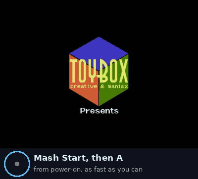

<sub>Power-on to the house at full speed. The badge shows the button being pressed: mash **Start** through the logos and the title, then **A** through the diary.</sub>

### 3.2 Sparrows at the door
*Sunny mornings only: no sparrows come to the farm in the rain, and the rainy pages have no sparrow box.*

As Jack walks out of the house, look at the door: **two sparrows by the door** mean your menus were 5–6 frames late.
That morning has its own table (its own set of the lab's plays, section [How the odds are worked out](#how-the-odds-are-worked-out)). Tick **Sparrows at the door** on the page (or press **S**) before the pier. No sparrows
by the door: leave it unticked. (Sparrows also appear on some slower mornings that no table covers.)

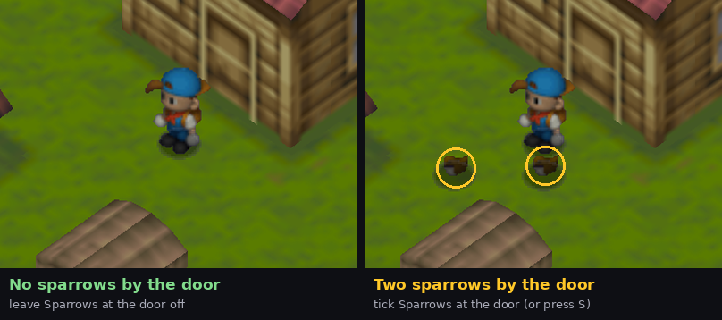

<sub>The same moment on the farm, as Jack steps out of the house, on two mornings. **Left:** menus 0–4 frames late, nothing by the door: leave the box off. **Right:** menus 5–6 frames late, two sparrows by the door (circled): tick **Sparrows at the door** or press **S**.</sub>

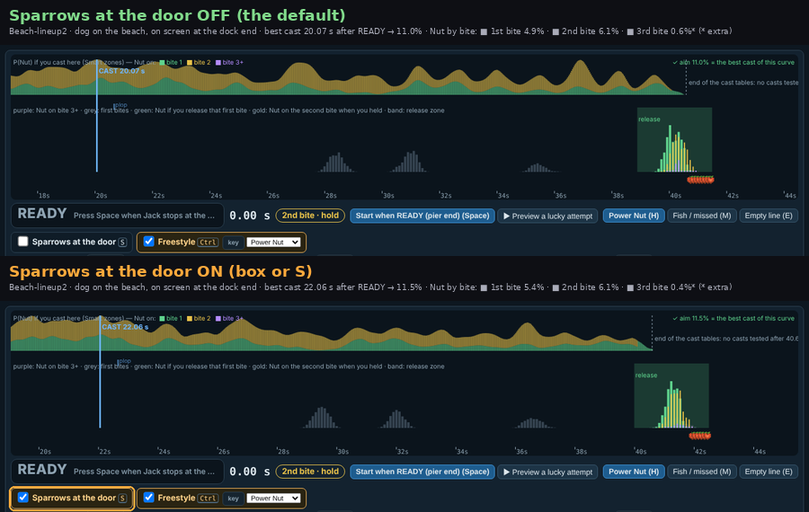

<sub><b>What the box changes in the app.</b> The sparrow mornings have their own table (menus 5–6 frames late, so the whole route runs a little later and the dog lines differ). Same page, same file: with the box off the best cast is <b>20.07 s</b> after READY at <b>11.0 %</b>; ticked (or <b>S</b>), the histogram is redrawn from the sparrow table and the best cast moves to <b>22.06 s</b> at <b>11.5 %</b>. A wrong box means the wrong table, so check the door every attempt.</sub>

### 3.3 General path (one held direction per screen)
- **House:** hold **up-left** through the fade-in, cut **down-left** around the table, then **down** out of the door.
- **Farm:** hold **left** to the exit.
- **Crossroads:** **left**, then cut **down-left**.
- **Ranch:** hold **down-right** to the beach. Keep holding it through the black screen into the beach.

<table>
<tr>
<td valign="top" width="50%">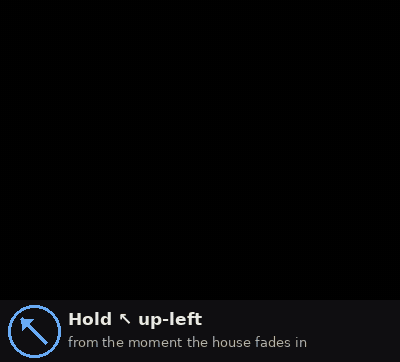<br><sub><b>House</b>: hold ↖ up-left while it fades in (Jack can't move for the first few seconds), ↙ down-left around the table, then ↓ down out of the door. You have about <b>4 game frames (0.13 s)</b> of slack here.</sub></td>
<td valign="top" width="50%">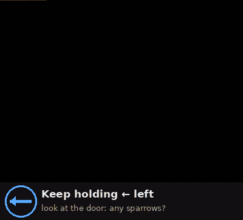<br><sub><b>Farm</b>: one held ← left to the exit. Look at the door while it fades in (section 3.2).</sub></td>
</tr>
<tr>
<td valign="top" width="50%">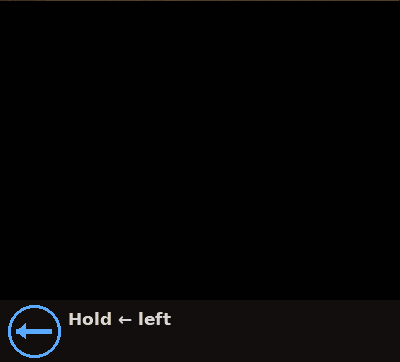<br><sub><b>Crossroads</b>: ← left, then ↙ down-left to the ranch. The farm and the crossroads together allow about <b>3 game frames (0.10 s)</b>.</sub></td>
<td valign="top" width="50%">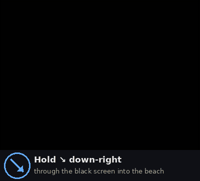<br><sub><b>Ranch</b>: hold ↘ down-right and keep holding it through the black screen into the beach.</sub></td>
</tr>
</table>

<sub>The badge under each clip shows the stick direction held; it turns orange at each turn. Recorded in an emulator from power-on with the timings the tables were built on.</sub>

### 3.4 The beach: the zigzag
The beach is three legs and two turns. Never stop and never walk straight down.
1. **Down-right** (held from the ranch, through the fade-in). Jack starts moving about a second after the beach
   appears.
2. **First cut, down-left:** the moment Jack clears the **small wall**, on that game frame or the next. This is the
   "tight first turn". Then **hug the back wall** going down-left.
   - Turned a little late (Jack drifts off the wall)? Correct by pressing up a moment and carry on. It costs up to half
     a second, and the tables cover it: those are the **Small fix** and **Big fix** presets (section 5).
3. **Second cut, down-right, onto the pier:** anywhere across the pier's width. Where you cut decides where Jack stops
   at the end: **Early** = near edge, **Middle**, **Late** = far edge. All of them are in the tables.
   - Cut outside the pier's window (too early or too late) and Jack does not make it onto the pier. That attempt is not
     in the tables: restart.
4. **Hold down-right** until Jack stops at the water at the end of the pier. He is now facing the sea, ready to cast.
   This moment is **READY**.

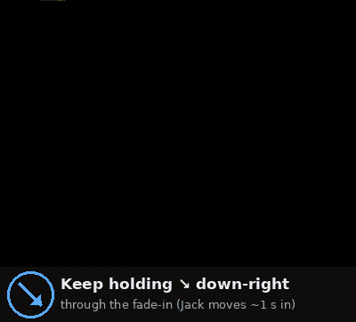

<sub>The beach: keep ↘ through the fade-in, ↙ the moment Jack clears the small wall, slide down the back wall, ↘ onto the pier at the bottom of the wall, and hold it until Jack stops at the water: <b>READY</b>. The tables allow your first step up to <b>half a second</b> late; the cut onto the pier has a window of about <b>a third of a second</b> (11 game frames).</sub>

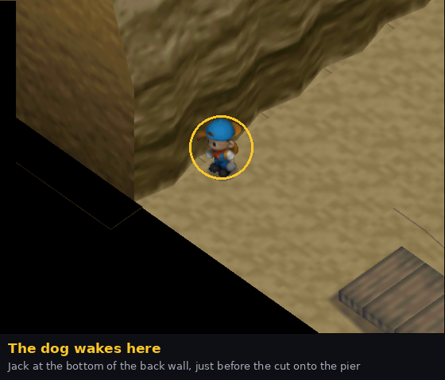

<sub><b>The moment the dog wakes.</b> The dog is asleep until the camera, following Jack, comes near it. On this route that happens when Jack reaches the bottom of the back wall, a frame or two before the cut onto the pier (the dog itself is still just off screen, by the pier's legs). Everything up to this moment decides your dog line: your first step, the first cut, and any fix along the wall, so if Jack drifts off the wall, fix it straight away: a fix only counts until here. After it, nothing Jack does changes the dog or the random numbers (checked frame by frame in the emulator); the cut onto the pier only changes when you reach READY, and the tables cover that. (A cut at the very start of the pier window wakes the dog a frame or two sooner; those runs are in the tables too.)</sub>

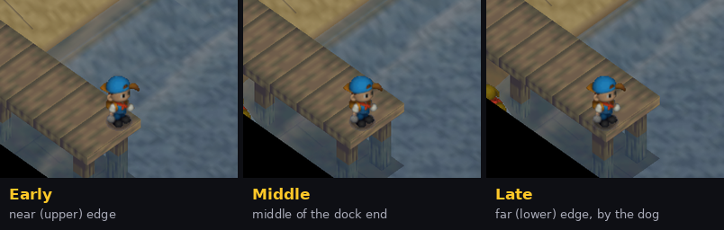

<sub>Where the cut onto the pier leaves Jack at the dock end: <b>Early</b> = near (upper) edge, <b>Middle</b>, <b>Late</b> = far (lower) edge, by the dog. All are in the tables; pick yours under <b>2nd cut</b> in the Lucky plan if you know it (section 5), or leave Any.</sub>

### 3.5 Space at the end of the pier (the control)
**Tap Space once, the moment Jack stops at the water.** That one tap starts the tool's stopwatch. Everything after it,
including the dog cards, the cast cue and the bite calls, counts from that tap. The tool allows for your reaction time
and learns your personal delay from your bite taps over time.

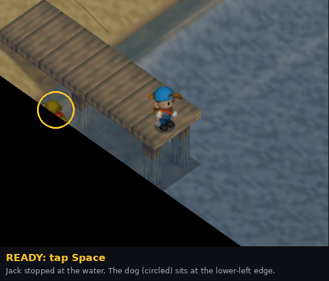

<sub><b>READY</b>: Jack has stopped at the water, facing the sea: tap Space now. The dog (circled) sits at the lower-left edge of the screen, half under the black border. If yours is somewhere else, your file is not set up like the lab's (section 2).</sub>

From here the hands are split: the **controller** casts (B) and reels; the **keyboard** is for the tool (Space taps,
the dog keys).

### 3.6 Stay awake
Jack lies down after **40 s** with no input. A red **WAKE JACK** line crosses the histogram 33.4 s after READY (and
every 33.4 s after that) while you are still waiting to cast. When it reaches the white line, push the stick
**down-right once**. That resets the nap timer and does not change the dog or the bites (measured in the lab). Never
push the stick after you have cast; fishing keeps him awake.

---

## 4. What the app starts with

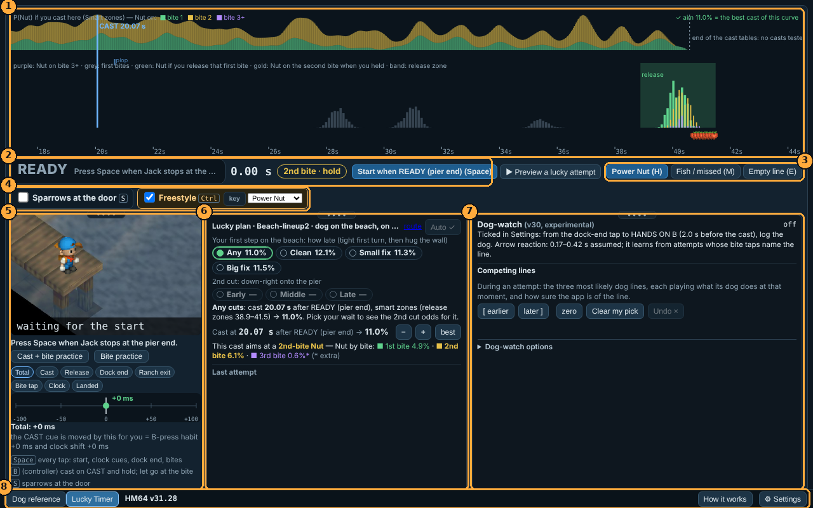

<sub><b>A fresh browser, nothing changed.</b> ① the histogram (section 5) · ② the lamp with its countdown, the stopwatch, Start and ▶ Preview · ③ the result keys H / M / E · ④ the Sparrows and Freestyle boxes, Freestyle's target menu · ⑤ the picture of Jack, the practice drills and your timing compass (both on the Settings page since v32.16) and the key list · ⑥ the Lucky plan (presets and the cast time) · ⑦ the dog-watch (section 6) · ⑧ the footer: How it works and ⚙ Settings (⚙ Options since v32.16; from v32 the footer's left end links to the ⌂ Hub and the Casting tables; the picture shows v31's two tabs there). Panels ⑤ ⑥ ⑦ can be dragged into any order by their •••• grip.</sub>

A fresh browser opens the Lucky Timer ready:
- Route **Beach-lineup2 · dog on the beach** (the file in section 2), **Sparrows at the door** off.
- Start: **one Space tap when Jack stops at the end of the pier**. With this start the app offers no taps on the way in
  and hides **Pier only**; both come back only if you choose the fade-in start in Setup & review → L2.
- **Dog-watch on**, **5 dog cards**, the most likely dog **on the right**.
- **Freestyle on**: you choose the cast from your dog's bars (section 7). Switch it off (**Ctrl** or the box) for the
  app's own cast suggestion (section 5).
- Dog-watch animation keys: numpad **0** idle · **1** sit · **2** stand · **4** walk · **5** run · **6** sleep · **7** sniff ·
  **8** bark · **9** shoulder, plus **R** rollover · **F** flapper · **G** good-boy · **O** mess · **B** wiggle-bum.
- Front panels: picture of Jack · Lucky plan · dog-watch (drag the •••• grips to reorder).

Everything can be changed, and the browser remembers your changes. If you opened an earlier build on the same site, its
stored settings win over these defaults; change them by hand, or clear the site's data in the browser to start fresh.

Your settings, practice data and attempt history are stored **in your own browser**, for this site. Nothing is sent
anywhere or shared with other players. Clearing the browser's site data resets the tool.

The page also works offline: save it with your browser (File → Save Page As…) and open the saved file. A saved copy
keeps its own settings, separate from the website's.

The **Lucky Timer** page is the tool. The **Casting tables** page (a link in its footer and in the hub) is the Dog
reference, a printable manual method; its first tab is [Optimal Blind Casting](#optimal-blind-casting) (more in section 10).

---

## 5. Layer 1 — the histogram and its cast suggestion
This is the app's own cast suggestion: the best cast for "any dog this route can produce". It shows while
**Freestyle is off** (it is on by default: press **Ctrl** or untick the box).

**The front page, top to bottom:** the histogram; a slim lamp strip (stopwatch, Start / Stop, result keys, the
Sparrows / Pier only / Freestyle boxes); three panels you can drag into any order by their •••• grip: dog-watch,
Lucky plan, and the picture of Jack with the key list.

**The histogram** scrolls from right to left like a rhythm game:
- The **white line** is *now*.
- The **bold blue CAST line** is when to press B. Press as it crosses the white line. The lamp, the countdown and the
  glow around the screen edge all hit zero at that same moment. If the tool has learned that you press late, the bold
  line sits that much early, and a dashed "ghost" line marks the unaltered moment.
- **Bars** show the chance of a Power Nut for a cast at each moment, coloured by the bite the Nut comes on: **green** =
  let go at the **1st** bite, **gold** = hold through the 1st bite and let go at the **2nd**, **purple** = a later
  bite. A bar's height = the share of the arrivals still in play (weighted by how often the route reaches them) that land
  the Nut there, blurred by your press spread as a bell curve ([how](#how-the-odds-are-worked-out)).
- **ⓘ What the bars mean** (under the histogram, v32.5) says the same for the mode you are in right now: the app's odds,
  freestyle without a dog, or freestyle with your dog chosen.


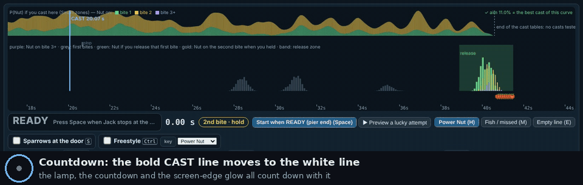

<sub><b>Freestyle off, ▶ Preview a lucky attempt (P).</b> The app plays the cues of one winning attempt so you can see the rhythm: the bold CAST line meets the white line (press B there and keep holding), the release windows follow on the histogram, bite 1 comes (keep holding B, tap Space as it bites) and bite 2 is the Nut (let go). The ▶▶ parts are sped up. A real attempt starts from your Space tap at READY instead.</sub>

**The Lucky plan panel** shows the route name and **Cast at X after READY**, with − / + / best to move it, and
**Auto ✓ / Back to best** (lit when you moved something by hand: click it to go back to the best plan). It also has two
rows of buttons describing your run, each with its own best cast and odds:
- **Your first step on the beach:** Any / **Clean** (tight first turn, no correction) / **Small fix** (a small correction,
  0.17–0.30 s late) / **Big fix** (a bigger one, 0.33–0.50 s late).
- **2nd cut:** Any / **Early** / **Middle** / **Late** (where Jack stopped across the end of the pier).

Pick what you actually did if you know it, or leave Any: a preset only keeps the lab's plays that went that way, so its odds
are those plays' odds. ★ marks the best 2nd cut for that first step. With the
pier-end start the plain suggestion is roughly **20 s after your tap at about 11 %** (shown live in the app; it
depends on the presets).

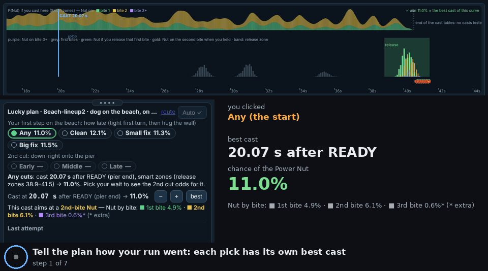

<sub><b>Each pick has its own best cast.</b> Any: <b>20.07 s · 11.0 %</b> → Clean: <b>36.96 s · 12.1 %</b> → Small fix: <b>20.14 s · 11.3 %</b> → Big fix: <b>36.77 s · 11.5 %</b>; with Clean, the 2nd cut: Early <b>37.01 s · 12.9 %</b>, Middle ★ <b>36.91 s · 13.1 %</b>, Late <b>36.79 s · 12.7 %</b>. The histogram is redrawn for every pick. If you are not sure how your run went, leave Any: it covers every timing in the tables.</sub>

**After the cast** the lamp reads the bites for you:
- **RELEASE** (e.g. **BITE 1 = NUT: RELEASE**, **RELEASE ON A BITE**) = let go of B at this bite.
- **KEEP HOLDING** / **HOLD · TAP THE BITE** / **HOLD → BITE 2** = hold B through this bite and tap Space as it bites.
  From the tap, the tool works out which frames and dog lines fit and forecasts the next bite.
- **DUD — RESET** = no Nut is left on this cast: reset and save the time.
- A **pink release line** shows the best moment to let go without looking (with its chance, "blind x %").

---

## 6. Layer 2 — find your dog and tune it to your N64
Once you have tapped Space at the end of the pier, the **dog-watch** panel opens with **cards**. Each card plays what
one dog line's dog is doing *right now*, with its share of the likelihood (e.g. "17 % L5 +3"): the line's weight × how
well it fits the keys you pressed, scaled so the cards add up to 100% ([how](#how-the-odds-are-worked-out)).
- "**+3**" means three "sister" lines have become the very same dog by now; they are shown on one card.

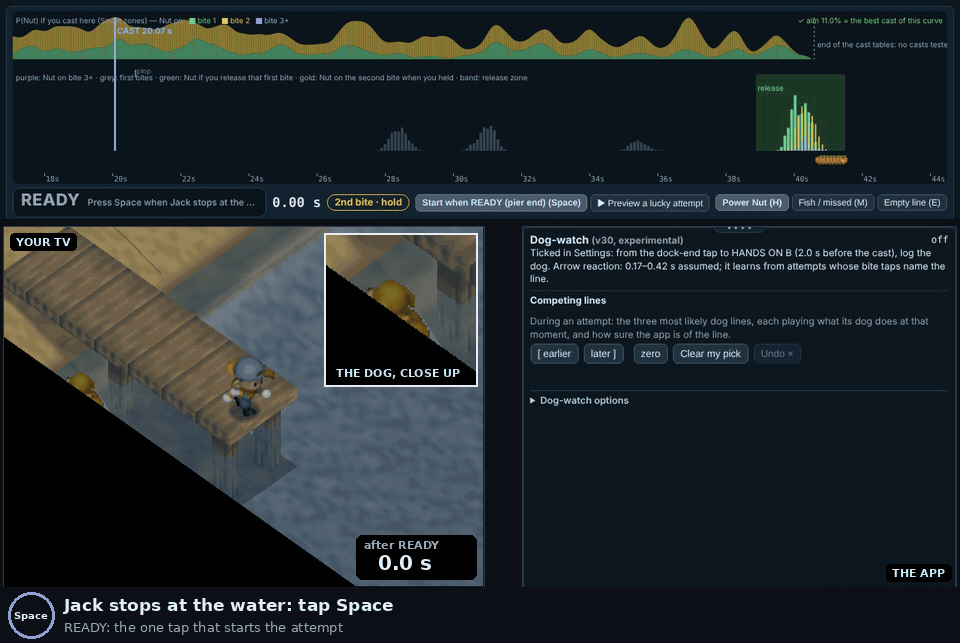

<sub><b>A real attempt, the TV and the app side by side</b> (the TV is the emulator running the same file and route; the close-up is the dog in the TV's lower-left corner). Space at READY; the cards play five dog lines; one arrow key as the dog turns (optional) and the matching card, L3, rises to the top on the right; click it; five presses of <b>[</b> line it up with the TV (−5 frames); the histogram now shows L3's own Power Nut cast frames.</sub>

**1. Choose your dog.** When a card does what the dog on your TV is doing, **click it** — or, when it is the most likely
card (the top one), press **Enter** (v32.5): no mouse needed. The other cards disappear and
the panel becomes the **calibration view**: your dog drawn large, with three frames of it underneath (one game frame
earlier, the tuned one, one later). The dog sits on the right by default (left / middle / right in Dog-watch options), so you can put it
nearest your TV.
- Wrong dog? **Backspace** (or click it again) gives you the row back.
- A card that clearly isn't your dog can be thrown out with its **×** (or **Delete** for the top card); Backspace or
  "Undo ×" brings it back.
- Optional, if you can't tell yet: key the dog's facing with the **arrow keys** (two keys = a diagonal) whenever it
  turns, and long animations on their keys (numpad 0 idle, 1 sit, 2 stand, 4 walk, 5 run, 6 sleep, 7 sniff, 8 bark,
  9 shoulder; R rollover, F flapper, G good-boy, O mess, B wiggle-bum). Each key re-weights the lines, so the right card
  rises to the top.

**2. Tune it.** A card plays at the tool's best guess of your timing, so it can run a little early or late. Press
**[** (earlier) and **]** (later) to move it one game frame (33 ms), or **Shift + [ / ]** for 10 frames, until the
large dog turns **exactly** with the dog on your TV, then press **Enter** (timing set). The three small frames show what one frame either way looks like. Practise this on the [Dog practice](#dog-practice-try-it-without-a-console) page.

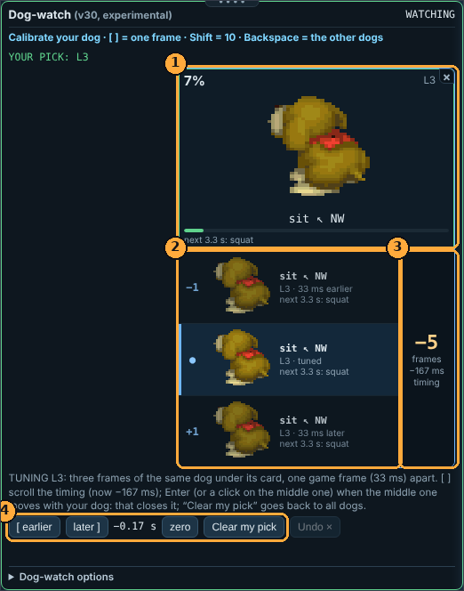

<sub><b>The calibration view.</b> ① your dog, large (it sits on the side the Dog-watch options set: right by default) · ② the same dog one game frame earlier, tuned, and one frame later · ③ how far you moved it (here −5 frames = −167 ms) · ④ [ earlier / later ], zero, Clear my pick (the same as the keys).</sub>

**3. The histogram changes.** With a dog chosen, the histogram stops showing odds for "any dog". It shows **that dog's
own Power Nut cast frames** as bars, at your tuned timing, and the cast suggestion re-aims to the best cast still
ahead, on any bite. In the lab's simulated runs, attempts with the right dog chosen got about 30 % instead of
about 12–13 % with no dog chosen: knowing the line takes the averaging over every other line away.

**After the cast, the cards stay lit:** the card plays its dog *after* a cast on one particular frame. A card that
stays in step with your dog for more than about 3 s is the frame you landed on. Click it to **lock** that frame
(**[ ]** step it). The lamp then calls the bites exactly from the lab record: **HOLD · NUT IS BITE 2**,
**LET GO AT BITE 1 · NUT**, or **NO NUT ON THIS CAST**. Neighbouring frames show the same dog for 1–3 s after the cast
and then part, so a card parting early just means "not this exact frame".

---

## 7. Layer 3 — Freestyle: choose your own cast
Freestyle is a separate mode for when your dog is chosen and tuned: **you** choose when to cast, from your dog's own
Power Nut frames. No reflex correction is needed, because the dog on screen and the dog on your TV are in step.

**Switch it on and off** with the **Freestyle** box or the **Ctrl** key (changeable). It works before or during an
attempt. Beside the box, pick the target: **Power Nut** (default), or large / medium / small fish.

**What you see** (with a dog chosen; without one the histogram asks you to click your dog):
- **Bars** = your dog's cast frames that catch the target, coloured by bite: **green** = the 1st bite after the cast is
  the catch, **gold** = hold through the 1st bite, the 2nd is the catch.
- **Doubles / triples** (marked **×2** with a band behind them) = two or three neighbouring frames that catch the target
  on the same bite at the same moment. They give you a wider window (67–100 ms instead of 33 ms), so they are the best
  targets.
- The lamp counts down: **NEXT DOUBLE · GREEN · 4.2 s**. For your dog's last double it says **LAST DOUBLE** and pulses
  red from 8 s before (with the glow setting on).
- **Threads:** under the bars is a thin **release lane**. Every bar has a thread from the bar down to the moment its
  catch can be reeled in. Once you pass a bar, its thread's top stays on the white line and the thread swings upright.
  **When it stands straight up, let go of B** (only if you cast on that bar). The lamp says it too: **GREEN THREAD · LET
  GO IN 1.2 s → LET GO NOW**.
  Don't want the lane? Untick **⚙ Options → Lucky Timer → Show the release window under the histogram** (v32.6; the button was called ⚙ Settings until v32.16): the
  lane and its threads go, the bars take the whole histogram as before the lane came, and the lamp still counts down to
  each let-go. In the app's own odds (no dog chosen) the same box hides the lane of bites after the cast with its
  release band.
- **WAKE JACK** lines keep coming every 33.4 s until you cast (section 3.6).

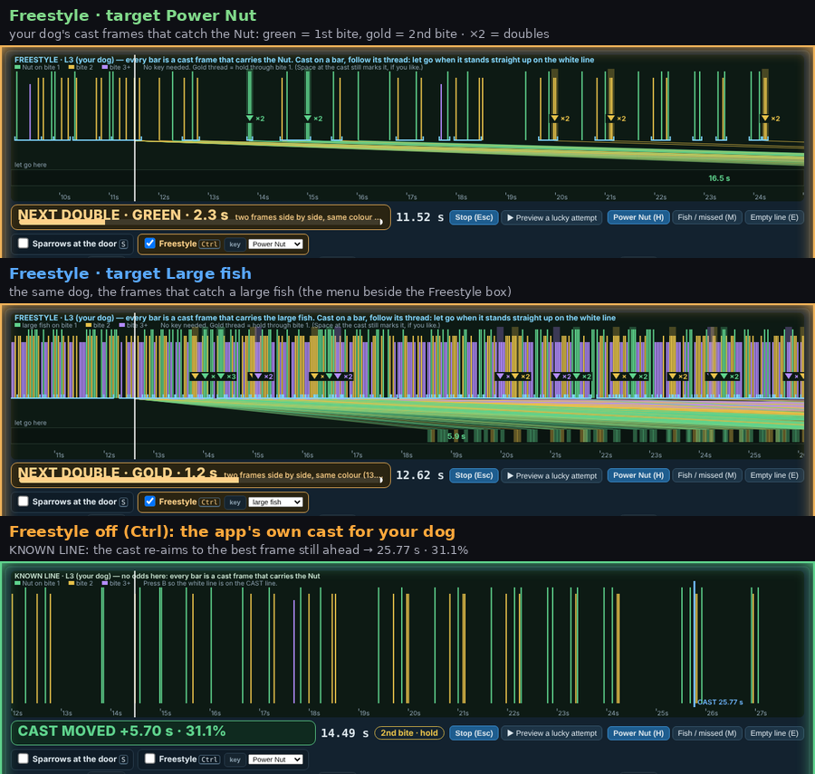

<sub><b>The same dog (L3), three views.</b> Top: Freestyle, target <b>Power Nut</b>: only the frames that catch the Nut, doubles marked ×2. Middle: target <b>Large fish</b>: the frames that catch a large fish. Bottom: <b>Freestyle off</b> (Ctrl) with the dog still chosen: KNOWN LINE, the app's own cast moves to the best frame still ahead (here 25.77 s, 31.1 %).</sub>

**How to play it:**
- Watch the countdown, **press B on a bar**, ideally a double.
- **Simplest way, no keyboard needed:** cast in a **green** bar's window and let go at the **first nibble**. For a
  **gold** bar, hold through the first nibble and let go at the second.
- **Optional:** tap **Space as you cast**. The tool takes the nearest double (or group of bars) as the one you went for,
  leaves only that one's thread on screen, shows a pink release line inside its window, and grades the cast in the
  report: **INSIDE**, or **n ms EARLY / LATE**. **Backspace** = "that wasn't my cast". You don't need this; it only helps
  you focus on the release that's left.
- A freestyle attempt with no cast stops by itself at the end of the data (120 s after READY), without logging
  anything.

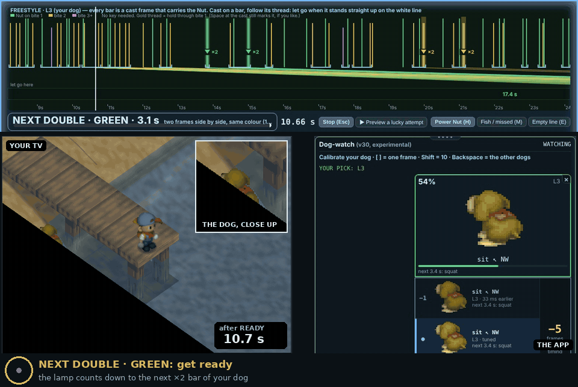

<sub><b>The same attempt, continued.</b> NEXT DOUBLE · GREEN counts down; press B on the ×2 bar (here with a Space tap as you cast, which marks it); hold B while the cast's thread swings up; when it stands upright the lamp says let go: the first nibble is the <b>Power Nut</b>, on the TV too. Then H. In the emulator, casts on the two frames of this double both give the Nut; the frames either side give a small fish.</sub>

For a sense of scale (lab calculation): the best group of bars on a dog line is worth about **29 %** with a press
spread of ±150 ms and about **47 %** at ±60 ms. With the dog known and tuned, the bars are yes or no, so the only thing
left between you and the Nut is how close to the bar your press lands. In other words, steadier hands are worth more than anything else.

---

## 8. Ending an attempt, results and reports
- **H** = caught the Power Nut · **M** = caught a fish / missed · **E** = empty line · **Esc** = stop without logging.
- **Bite taps** (Space at a bite while holding B) are what the tool learns from: your reaction, your clock, which dog
  lines you really land on. They are stored even when you press Esc.
- Setup & review → **L4 · Attempts**: every attempt has a **Report** (the cast moment close up: target, where your press
  landed, the dog line, the locked frame) and **Copy report** for sharing. **Remove** takes a bad attempt out of
  everything the tool learned (**Undo** puts it back). **Export** / **Clear** for the whole log.

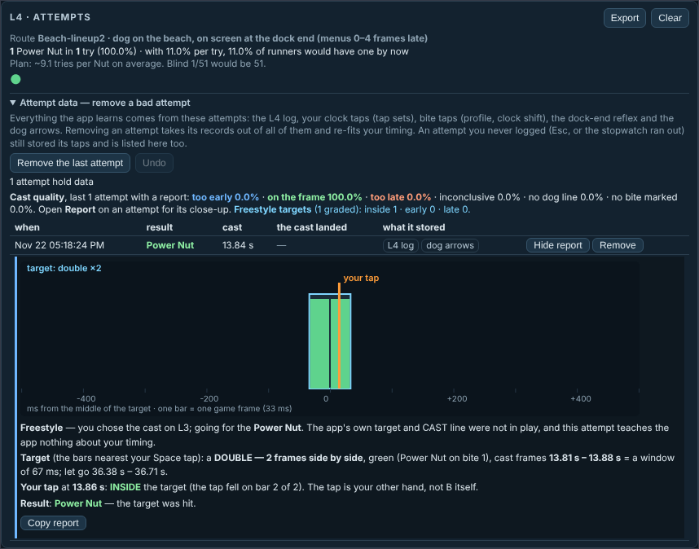

<sub><b>L4 after the attempt above.</b> One Power Nut in one try; the report shows the target (a double, 67 ms wide), where your Space tap landed (INSIDE, on bar 2 of 2) and what to let go at. <b>Remove</b> takes an attempt out of everything the tool learned.</sub>

---

## 9. Practice drills
Since v32.16 the drills are on the [Settings](#settings-your-keys-timing-and-practice-in-one-place) page (one place for
every page), with the same timings and the same records as before. For the dog itself (tuning, reading, a whole attempt
with no console) see [Dog practice](#dog-practice-try-it-without-a-console).
- **Cast + bite practice:** the whole motion as on the N64. The histogram counts down to CAST, you press Space (or a
  controller button on a USB pad) on the cue and **keep holding**, Jack casts, a bite comes 1.4–5.2 s later, and you
  **let go** the instant the rod dips. The lamp gives both results, e.g. **CAST +42 MS · CAUGHT 231 MS**. These feed your
  press habit and your release reaction.
- **Bite practice:** only the bite. Hold, let go when the rod dips. A bite can be caught for 20 video frames (334 ms):
  CAUGHT / LATE / TOO EARLY.
- **Esc** stops a drill.

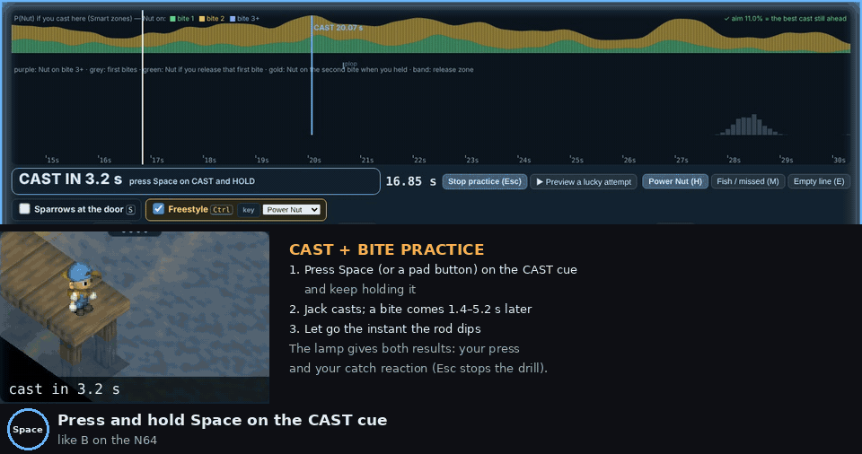

<sub><b>Cast + bite practice</b> (in the Lucky Timer's preview, as it was until v32.16; the Settings page runs the same drill). Hold Space from the CAST cue, let go when the rod dips. The lamp gives both results: here the press was 43 ms late and the catch took 204 ms.</sub>

---

## 10. Every setting, explained

### Front page
| Control | What it does |
|---|---|
| **Start / Stop**, **▶ Preview a lucky attempt** | Start / stop by mouse (Space starts, Esc stops); Preview plays an attempt's cues with no console. |
| **Power Nut (H) · Fish / missed (M) · Empty line (E)** | Log the result (the same as the keys). |
| **Sparrows at the door** (S) | Use the table for mornings with two sparrows at the house door (section 3.2). |
| **Pier only** (X) | Only shown with the fade-in start: a one-attempt override that makes the next (or last) Space the end-of-pier tap. Hidden (and X does nothing) with the default one-tap start, which already is that tap. |
| **Freestyle** box, **key** button, target menu | Freestyle mode on / off, change its key (default Ctrl), target Power Nut / large / medium / small fish. |
| **Dog-watch** panel: [ earlier · later ] · zero · Clear my pick · Undo × | Tune the dog cards by a frame, back to zero, drop your chosen dog, undo removed cards. |
| **Dog-watch options** → Dogs on screen 3 / 5 / 7 | How many cards (default 5). |
| → most likely dog on the left / in the middle / on the right | Where the top card (and the chosen, large dog) sits (default right). |
| → **Mouseover forecast** (off) | Hover a card to list that dog's next moves with countdowns. |
| → **No missed turns once I start** + late arrows allowed up to … ms | Strict arrow logging: once you start keying, every turn must be keyed (late entries allowed up to the limit). Lines that don't show your sequence drop out. |
| **Lucky plan** panel | See section 5 (presets, Cast at … − + best, Auto ✓ / Back to best, the last attempt in a few lines). |
| **Cast + bite practice**, **Bite practice** | On the Settings page since v32.16 (section 9). |

<table>
<tr>
<td valign="top" width="50%">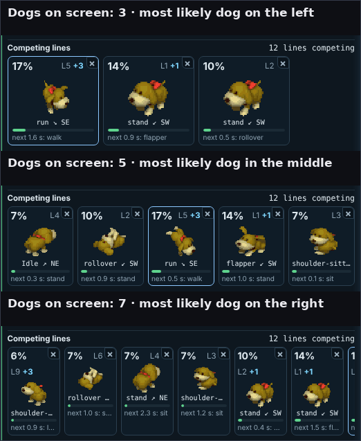<br><sub><b>Dog-watch options</b>: how many cards (3 / 5 / 7), and where the most likely dog sits. In a 1280-pixel-wide window the 7th card runs past the panel's edge.</sub></td>
<td valign="top" width="50%">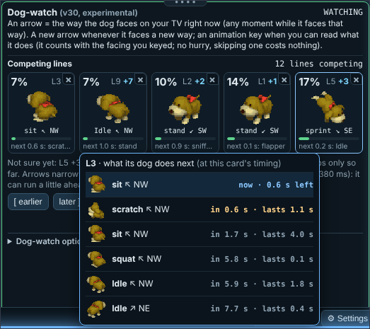<br><sub><b>Mouseover forecast</b> (off by default): hover a card for that dog's next moves, with countdowns at the card's own timing.</sub></td>
</tr>
</table>

### Setup & review (the fold at the bottom)
**L1 · Plan details**
| Setting | What it does |
|---|---|
| **After the cast:** Auto / Smart zones / 1st bite / 2nd bite / 2nd bite + tap | The release rule the plan uses. Auto picks the best. Smart zones: let go of the 1st bite only inside a release window, otherwise hold and tap it. 1st bite / 2nd bite: fixed rules. 2nd bite + tap: always hold through bite 1 and tap it, so the tool can forecast bite 2 or call DUD. |
| **Aim for:** best odds per attempt / fastest Nut | Best chance per attempt, or the best chance per minute (an earlier cast with slightly lower odds). "An attempt costs … s besides the wait" = your reset time, used for the per-minute maths. Ignored while dog-watch is on (the cast stays on best odds). |
| **Personalized cast suggestion (experimental)** | Aims with your own measured timing (B presses, clock taps, how well your offset is known) instead of a plain bell curve. A loose or lopsided timing then prefers wide plateaus over narrow peaks. |
| **P(Nut) overview** | The chance for a cast at each moment with your timing spread. Click it to choose another cast time. |
| **How to do this attempt** | The route and the start in words. |


<sub><b>L1, cause and effect.</b> Auto (= Smart zones here): <b>20.07 s · 11.0 %</b>. 1st bite: the plan changes completely (cast at <b>0.48 s</b>, <b>6.5 %</b>, only green bars). 2nd bite (and 2nd bite + tap): <b>36.92 s · 8.4 %</b>. Aim for fastest Nut: nothing moves while dog-watch is on, as the panel says (the cast stays on best odds).</sub>

**L2 · Start & taps**
| Setting | What it does |
|---|---|
| **Start the stopwatch** | **"when Jack stops at the dock end (READY)"** (default): one Space tap, nothing on the way in. The other option, "when the beach starts to fade in", is a multi-tap start for experienced runners with slightly higher odds (11.6 % vs 11.0 %); choosing it brings back the tap strategies and **Pier only**. |
| **Start key** | Space by default; set on the Settings page. |


<sub><b>L2, the two starts.</b> Left, the default: one tap at READY, nothing on the way in. Right, the fade-in start: the <b>Pier only</b> box comes back in the lamp row, and L2 gains the tap strategy, the beach cue and the clock-tap settings.</sub>

**L4 · Attempts**: section 8.

**L5 · What your attempts teach** (until v32.16 "Your timing": the timing picture, *Set by hand* and the practice folds are on the [Settings](#settings-your-keys-timing-and-practice-in-one-place) page now; L5 starts with one line of the timing in use and a link there)
| Fold | What it does |
|---|---|
| **Is the app working?** | Your bite taps vs the tables (do they fit a dog line, or are they "off the tables"?), Nuts expected vs caught, where your casts land. |
| **What the app learns, and its limits** | What is learned, from what, and how far it may move. |
| **Your data: clear stats** | Clear any one store (attempt log, bite taps, dog-watch records, clock taps, cast practice, bite practice) or **Clear all stats**. Settings and keys are kept. |
| **Your dog lines** | Which lines your attempts were on, vs how common the lab found them. "Also count what the dog-watch saw" is experimental. |
| ~~Bite practice, Cast practice~~ (Settings page since v32.16) | Statistics and options of the drills ("tap instead of hold-and-let-go", "use it as my bite-tap delay", "moving cast line", "full wait", "hold on to the bite and let go", "Copy to my hand-set values", "Forget …"). |


<sub><b>L5 after one attempt</b> (v31; the timing picture and the table are on the Settings page since v32.16). The timing picture (each dot is something measured about you), the table of what has been learned so far, and the open folds below it.</sub>

### ⚙ Options → Lucky Timer tab
The Lucky Timer's own **⚙ Options** button (called **⚙ Settings** until v32.16, when the [Settings](#settings-your-keys-timing-and-practice-in-one-place) page took that name for your keys, timing and practice).
| Setting | What it does |
|---|---|
| **Route (save / dog spot)** | Which lab table to use: **Beach-lineup2** for the file in section 2. The others are older saves and routes. |
| **Watch the dog at the dock end** | Turns the dog-watch panel (cards) on. |
| **Facing keys** arrow keys / W A S D | Keys for the dog's facing: on the Settings page since v32.16. |
| **Hands on B (stop logging) before the cast (s)** | Dog-watch logging closes this long before the cast (default 2 s). |
| **Dog-watch keys** (Settings page since v32.16) | Reassign the animation keys (defaults in section 4) and the earlier / later card keys. Keys the tool itself uses are refused. **Reset these keys** returns to the defaults. |
| **Release line** | Show the pink release line (normal mode: best blind release; Freestyle: the middle of your marked cast's window). |
| **Release window** (v32.6) | Show the release window under the histogram: in Freestyle the "let go here" lane and the threads to it; otherwise the lane of bites after the cast with its release band. Off: the cast bars take the whole histogram; the lamp's let-go countdown stays. On by default. |
| **Cast tap** + precision | Optional: also tap Space when you press B, so the tool knows your real cast time. On the Settings page since v32.16. |
| **Glow around the screen edge** | The lamp's colour around the whole screen edge, for the corner of your eye. In Freestyle it also covers the LAST DOUBLE pulse. |
| **Facing when casting** SE / E | Only changes the picture of Jack. |
| **Sound too** / … release-window sounds | Beeps with the visual cues (off by default). *Sound too* is on the Settings page since v32.16. |
| **Load your own angler frames** / Stick figure | Change the picture of Jack. |


<sub><b>⚙ Options → Lucky Timer</b> (the picture is from before v32.16, when it was ⚙ Settings: the key table, the cast tap and sound are on the Settings page now). The route, dog-watch, the key table (every animation with its share of the wait and its key), the release line, cast tap, glow, sound and the picture of Jack.</sub>

### ⚙ Options → Console & shared timing / Calibration & data tabs
Mostly settings of the older "Dog Oracle" page, which this build no longer shows. The two that matter are on the Settings page since v32.16:
- **Console game update (ms; NTSC N64 = 33.430)**: **leave it at 33.430.** If it is changed, the front page shows a red
  warning with a one-click fix.
- **Your tap delay, mean (ms)**: the tool's first guess for your bite-tap delay, until it has learned yours.


<sub><b>⚙ Options → Console & shared timing</b> (before v32.16). The game update stays at 33.430 ms.</sub>


<sub>If it is changed (here to 33.333 ms), the lamp row says so in red; one click puts it back.</sub>

### Casting tables page (the Dog reference)
A manual method for when the live tool is not wanted: what the dog is doing as Jack stops at the end of the pier →
which line you are likely on → how long to wait before casting (best-odds and quick casts per behaviour), the
"harbinger" behaviours that give a line away, and a simple Space stopwatch (Space when Jack stops, Esc to stop; click
a cast time in the tables to count down to it). Every tab has a one-line ⓘ on what its numbers are; Optimal Blind Casting has
a fold, *How these odds are worked out*. Tabs: **Optimal Blind Casting** (the list above, first) · **First 10
seconds, by line** · **As you stop** · **Harbingers**. Casts reach 75 s after Jack stops (the Power Nut ends there); a
cast after 40 s says so and needs the push ↘ at about 33 s (a cast after 73 s a second one at about 67 s); the
stopwatch shows PUSH THE STICK ↘ NOW at those moments.
Its own settings: **Table** (Beach-lineup2 for the file in section 2), **Sparrows at the door** (S), **Aim for** best odds or a quick cast of **at least** n %.
Since v32.16 the **timing spread** every aimed cast's odds are worked out with and **how much the stopwatch starts before
your key press** are yours, from the [Settings](#settings-your-keys-timing-and-practice-in-one-place) page: your timing
spread (auto from your B presses, or set by hand; ±150 ms until then) and your start-tap delay (plus the clock shift the
Lucky Timer has learned from your bite taps). The line above the tables says which values are in use. **Print the
tables** gives a paper copy.


<sub><b>The Casting tables page</b> (the Dog reference, the manual method) on its first tab, Optimal Blind Casting. The picture is from v31, where it was a tab of the one page.</sub>

---

## 11. Keys and feedback

### Keys
| Key | When | Does |
|---|---|---|
| **Space** | at the end of the pier | starts the attempt (the stopwatch) |
| **Space** | after the cast, holding B | marks a bite (the tool forecasts the next one) |
| **Space** | Freestyle, as you cast (optional) | marks your cast |
| **B** (controller) | — | cast, hold, let go. The tool never sees it |
| **Ctrl** | any time | Freestyle on / off (changeable) |
| **S** / **X** | before the pier | sparrows at the door / pier-only override (X: fade-in start only) |
| **Arrows** (or WASD), **Numpad 0–9**, **R F G O B** | dog-watch | dog facing / long animations (section 4) |
| **[ ]**, **Shift + [ ]** | dog chosen | move the dog 1 / 10 game frames |
| **Enter** | dog-watch, no dog chosen yet | choose the most likely dog (the top card), as a click on it |
| **Enter** | a dog chosen, before the cast | its timing is set (close the three tuning frames) |
| **Enter** | after the cast | lock the frame of the card you are tuning |
| **Backspace** | — | undo: the chosen dog, a removed card, the last arrow, a Freestyle cast mark |
| **Delete** | dog-watch | remove the top card |
| **H / M / E / Esc** | — | Nut / fish / empty / stop without logging |

### Feedback that helps
Your browser and system; what you did; what you expected; what happened. **Copy report** from the attempt list
(Setup & review → L4) gives a text block worth pasting, and "Is the app working?" (L5) tells whether your runs fit the
tables at all.
